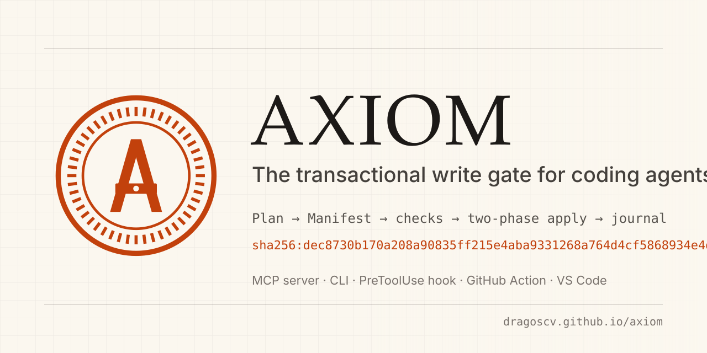
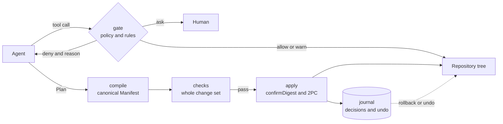

<div align="center">

<a href="https://dragoscv.github.io/axiom/"></a>

[](https://www.npmjs.com/package/@codai/axiom-mcp)
[](https://www.npmjs.com/package/@codai/axiom-mcp)
[](https://github.com/dragoscv/axiom/actions/workflows/ci.yml)
[](https://scorecard.dev/viewer/?uri=github.com/dragoscv/axiom)
[](https://www.bestpractices.dev/projects/15478)
[](LICENSE)
[](https://dragoscv.github.io/axiom/)
[](https://nodejs.org)

[Docs](https://dragoscv.github.io/axiom/) · [Quickstart](#quickstart) · [Install](#install) · [Harnesses](#harnesses) · [Packages](#packages) · [Changelog](CHANGELOG.md) · [Contributing](CONTRIBUTING.md)

</div>

**AXIOM is the transactional write gate for coding agents.** It sits between an agent and your
repository: every write and shell command the agent attempts is judged before it runs, and a
change set the agent submits is applied as one transaction you can undo byte for byte.

## What you get

- **A gate in 12 harnesses**: Claude Code, Copilot CLI, VS Code, Codex, Cursor, Windsurf, Gemini CLI, Junie, Cline, Kiro, OpenCode and any ACP client. One policy file decides which paths, secrets and shell commands (`git push --force`, `git reset --hard`, `rm -rf /`, …) are allowed, asked about or denied.
- **Digest-confirmed apply**: a change set is compiled to a canonical manifest; `apply` runs only with the digest you inspected, re-checks every file's prior hash at commit (two-phase), and rolls back to the byte-identical tree on any failure.
- **Session undo**: `axiom journal undo --session <id>` restores every file one agent session wrote, including allowed writes outside the repository.
- **A journal you can read**: relaxed and recorded decisions go to `.axiom/decisions.jsonl` (redacted); `axiom explain last` says which rule decided, from which profile, and how to fix it; `axiom report` renders a static HTML report.
- **Attestations**: DSSE (Ed25519) signatures and in-toto statements ([apply](https://dragoscv.github.io/axiom/spec/attestation/apply/v1/), [agent decision](https://dragoscv.github.io/axiom/spec/attestation/agent-decision/v0.1/)) that `gh attestation verify` can check.

**No telemetry.** AXIOM sends nothing anywhere. It reads and writes only the roots you allow
and `~/.axiom/`; the only outbound network access is a `ref` source fetch you opt into with
`--allow-net`.

## Quickstart

```sh
npm i -g @codai/axiom-mcp
cd your-repo
axiom setup init          # detects the harness, writes the hook + MCP entry + .axiom policy
axiom setup doctor        # bin on PATH, hook wired, gate latency, policy valid (exit 2 = a check failed)
```

`setup init` writes an **enforcing** policy: the built-in deny list (`.git/**`, `.env*`,
lockfiles, `node_modules`, …), the `house` command pack, and four hard codes that no mode or
override can relax: `house.forcePush`, `house.resetHard`, `house.cleanForce`,
`house.worktreeRemoveForce`. Preview it first with `axiom setup init --dry-run`.

Now ask the agent to force-push, or to write `.env`. The harness blocks the call and the agent
is told why (the hook also prints the reason on stderr):

```text
AXIOM GATE DENY house.forcePush: Force-push rewrites remote history, --force-with-lease included; ask the user first.
AXIOM GATE DENY path.deny: path matches a denied glob (.env)
```

Ask why, at any time:

```sh
axiom explain last        # decision, rule, profile, the command or path, and FIX: what to do instead
```

With `"undo": true` in the gate policy, the gate keeps the pre-image of every file it lets
through, so one session can be rolled back after the fact:

```sh
axiom journal undo --session <agent-session-id> --dry-run   # what would be restored
axiom journal undo --session <agent-session-id>             # restore it; conflicts are skipped and reported
```

Trying the gate before enforcing it? Set `"mode": "warn"`: denies become warnings the agent
sees (hard codes still deny), and `axiom setup stats` / `axiom setup suggest-profile` show what
would have been blocked. Every key: [profiles.md](docs/reference/profiles.md#gate-keys).
The full walk-through, including a first transactional apply:
[quickstart](docs/getting-started/quickstart.md).

> [!WARNING]
> Hooks need the global bin. `npx` takes seconds to resolve, the harness times the hook out,
> and every harness fails **open** on a timeout.

## Install

| Channel | How | Notes |
|---|---|---|
| VS Code Marketplace | [`dragoscv.axiom-axm`](https://marketplace.visualstudio.com/items?itemName=dragoscv.axiom-axm) | "AXIOM": gate status bar, Doctor / Init / Stats / Explain commands, `.axm` language support |
| Open VSX | [`dragoscv/axiom-axm`](https://open-vsx.org/extension/dragoscv/axiom-axm) | the same extension for Cursor, VSCodium, Windsurf, Gitpod |
| npm, global bin | `npm i -g @codai/axiom-mcp` | bins `axiom`, `axgate`, `axiom-mcp`; Node ≥ 22.14; **required for hooks** |
| npm, no install | `npx -y @codai/axiom-mcp mcp --root .` | MCP server only |
| Standalone binary | `curl -fsSL https://dragoscv.github.io/axiom/install.sh \| sh` | linux-x64/arm64, darwin-x64/arm64; no Node |
| Standalone binary | `irm https://dragoscv.github.io/axiom/install.ps1 \| iex` | win-x64; no Node |
| Homebrew | `brew install dragoscv/tap/axiom` | the same binary |
| GitHub Action | `uses: dragoscv/axiom/action@v2` | verify a tree against a manifest, upload an attestation |
| MCP Registry | `io.github.dragoscv/axiom` | any registry-aware MCP client |

The bin is also installed as **`axgate`**. [Axiom, Inc.](https://axiom.co) ships an unrelated
CLI named `axiom`; if it is first on your PATH, call AXIOM as `axgate` (`axgate setup init`,
`axgate gate --stdin …`). Binaries ship with `SHA256SUMS` and Sigstore provenance, npm packages
with npm provenance: [SECURITY.md](SECURITY.md#verifying-what-you-download). Every channel:
[install.md](docs/getting-started/install.md).

## Harnesses

`axiom setup init --harness <name>` wires one; `auto` (the default) detects it from the files in
the repository.

| Harness | `--harness` |
|---|---|
| Claude Code | `claude` |
| GitHub Copilot CLI | `copilot` |
| VS Code (agent mode) | `vscode` |
| Codex | `codex` |
| Cursor | `cursor` |
| Windsurf | `windsurf` |
| Gemini CLI | `gemini` |
| Junie | `junie` |
| Cline | `cline` |
| Kiro | `kiro` |
| OpenCode | `opencode` |
| ACP clients (Zed, …) | none: run the agent through `axiom acp-proxy --root . -- <agent>` |

Hook files, payload formats, how a deny reaches each agent, and per-harness caveats:
[harnesses.md](docs/integration/harnesses.md).

## How it works



Policy lives in `.axiom/`: the gate reads `.axiom/axiom.json` (`{ version: 3, gate, checks, extends }`),
and check profiles are built-in or `.axiom/profiles/<name>.json`.
The **gate** judges each tool call in milliseconds (a resident daemon answers hooks in a few
milliseconds). The **pipeline** checks a whole change set ("touch the schema, touch the
migration", dependency budgets, secrets, paths) and applies it atomically. Terms:
[glossary](docs/concepts/glossary.md). Concepts: [pipeline](docs/concepts/pipeline.md),
[trust model](docs/concepts/trust-model.md), [invariants](docs/concepts/invariants.md).

## Surfaces

- **CLI**: noun groups (`axiom plan …`, `axiom journal …`, `axiom keys …`, `axiom hook …`,
  `axiom setup …`, plus `explain`, `report`, `pin`, `mcp`, `serve`, `snapshot`, `gc`, `schema`),
  generated from one command table; `axiom <command> --help` prints that command only. The 2.x
  verbs (`axiom gate`, `axiom init`, `axiom apply`, …) keep working as hidden aliases until 4.0.
  Every command: [cli.md](docs/reference/cli.md).
- **MCP server**: `axiom mcp --root <dir>`, stdio or Streamable HTTP. 19 tools; the default
  `core` set is the 6 an agent needs to write through AXIOM (`axiom_write`, `axiom_status`,
  `axiom_check`, `axiom_apply_dry_run`, `axiom_apply`, `axiom_rollback`); `--tools full` adds
  the plan, manifest and task plumbing. [mcp-tools.md](docs/reference/mcp-tools.md).
- **Hook**: `axiom gate --stdin --format <harness>`, fail-closed, or the resident daemon
  `axiom hook daemon`. [hooks.md](docs/getting-started/hooks.md).
- **GitHub Action**: fail a PR whose tree does not match the manifest an agent applied, and
  upload an attestation. [github-action.md](docs/integration/github-action.md).
- **VS Code extension**: [vscode.md](docs/integration/vscode.md).

## Packages

| Package | What |
|---|---|
| [`@codai/axiom-mcp`](packages/mcp/README.md) | **The published bin**: CLI, MCP server, gate hook and daemon, standalone-binary entry |
| [`@codai/axiom-schema`](packages/schema/README.md) | Zod schemas for every wire type, the closed `ERROR_CODES`, JSON Schemas (published at [`/schemas/v3/`](https://dragoscv.github.io/axiom/schemas/v3/Plan.schema.json)) |
| [`@codai/axiom-canon`](packages/canon/README.md) | JCS (RFC 8785), sha256, in-toto statements, DSSE envelopes |
| [`@codai/axiom-plan`](packages/plan/README.md) | Plan → ManifestBundle compiler: inline, CAS, `ref`, `patch`, `template` sources |
| [`@codai/axiom-checks`](packages/checks/README.md) | 18 predicates (incl. `expr.cel`, `expr.cedar`, `guard.external`), built-in profiles |
| [`@codai/axiom-apply`](packages/apply/README.md) | Containment, two-phase commit, journal, rollback, lock, PR mode, `verifyTree` |
| [`@codai/axiom-axm`](packages/axm/README.md) | The `.axm` plan language: parser, formatter, language server (`@codai/axiom-axm/lsp`, `axm-lsp` bin) |
| [`@codai/axiom-emitters-web`](packages/emitters-web/README.md) | Optional `template` emitter, loaded with `axiom plan compile --emitter @codai/axiom-emitters-web` |
| [`@codai/axiom-axm-lsp`](packages/axm-lsp/README.md) | Deprecated re-export of `@codai/axiom-axm/lsp`, kept through 3.x |

All public packages share one version and release together. `schema` and `canon` are leaves;
`plan`, `checks` and `apply` depend only on them; nobody depends on `mcp` (enforced by
`check-package-deps`). Design: [v2-architecture.md](docs/design/v2-architecture.md).

## Upgrading to 3.0

3.0 keeps 2.x inputs working: `axiom.dev/v2` plans parse, old verbs are hidden aliases, and
`.axiom/gate-profile.json` / `.axiom/profiles/*.json` are still read.
`axiom setup migrate --profile` writes the new `.axiom/axiom.json`. What changed and why:
[MIGRATION.md](MIGRATION.md#from-2x-to-30). Release history: [CHANGELOG.md](CHANGELOG.md).
Decisions and stories: [PLAN.md](PLAN.md) · [TRACKER.csv](TRACKER.csv).

## Development

pnpm 12 · Node ≥ 22.14 · TypeScript 7 · tsdown · Biome · Vitest 5 · fast-check · Changesets.

```sh
pnpm install --frozen-lockfile
pnpm lint          # biome check .
pnpm build         # before typecheck: exports point at dist/
pnpm typecheck
pnpm test
pnpm guards        # node scripts/run-guards.mjs: the repo invariants in scripts/check-*.mjs
```

All green with the output shown, a `.changeset/*.md` for any change under `packages/*/src`,
and the ripple closed. Details: [CONTRIBUTING.md](CONTRIBUTING.md) and `.github/instructions/`.

## Community

[Discussions](https://github.com/dragoscv/axiom/discussions) for questions ·
[Issues](https://github.com/dragoscv/axiom/issues/new/choose) for bugs and features ·
[SUPPORT.md](SUPPORT.md) · [SECURITY.md](SECURITY.md) (private reporting) ·
[CODE_OF_CONDUCT.md](CODE_OF_CONDUCT.md) · [CITATION.cff](CITATION.cff).

## License

[MIT](LICENSE) © Dragos Catalin Vladulescu.
