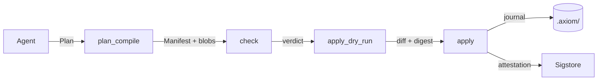

import { Badge, Card, CardGrid, Tabs, TabItem, LinkCard } from '@astrojs/starlight/components';
import pkg from '../../../../../packages/mcp/package.json';

<p class="not-content ax-version">
  <Badge text={`v${pkg.version}`} variant="note" /> <a href="https://github.com/dragoscv/axiom/blob/main/CHANGELOG.md">Changelog</a> · No telemetry
</p>

AXIOM sits between a coding agent and your repository. Every write and shell command the agent
attempts is judged **before it runs**, and a change set the agent submits is applied as **one
transaction** you can undo byte for byte.

<div class="ax-pipeline not-content">
<svg viewBox="0 0 880 120" role="img" aria-labelledby="ax-pipeline-title">
  <title id="ax-pipeline-title">Plan, Manifest, checks, apply, journal: every arrow is a hash boundary</title>
  <path class="line" d="M96 60 H176 M272 60 H352 M448 60 H528 M624 60 H704" />
  <g class="node"><rect x="8" y="38" width="88" height="44" rx="3"/><text x="52" y="65" text-anchor="middle">Plan</text></g>
  <g class="node seal"><rect x="176" y="38" width="96" height="44" rx="3"/><text x="224" y="65" text-anchor="middle">Manifest</text></g>
  <g class="node"><rect x="352" y="38" width="96" height="44" rx="3"/><text x="400" y="65" text-anchor="middle">checks</text></g>
  <g class="node seal"><rect x="528" y="38" width="96" height="44" rx="3"/><text x="576" y="65" text-anchor="middle">apply</text></g>
  <g class="node"><rect x="704" y="38" width="168" height="44" rx="3"/><text x="788" y="65" text-anchor="middle">.axiom/ journal</text></g>
  <text class="caption" x="224" y="104" text-anchor="middle">sha256(JCS(body))</text>
  <text class="caption" x="576" y="104" text-anchor="middle">confirmDigest · pre-image re-verified · 2PC</text>
</svg>
</div>

<CardGrid stagger>
  <Card title="A gate in 12 harnesses" icon="approve-check">
    Claude Code, Copilot CLI, VS Code, Codex, Cursor, Windsurf, Gemini CLI, Junie, Cline,
    **Kiro**, **OpenCode** and any **ACP** client. One policy file decides which paths, secrets
    and shell commands are allowed, asked about or denied.
  </Card>
  <Card title="Digest-confirmed apply" icon="seti:git">
    A change set compiles to a canonical **Manifest**; `apply` runs only with the digest you
    inspected, re-checks every prior hash at commit, and rolls back to the byte-identical tree
    on any failure.
  </Card>
  <Card title="Session undo" icon="random">
    `axiom journal undo --session <id>` restores every file one agent session wrote through the
    gate, including allowed writes outside the repository.
  </Card>
  <Card title="Explainable" icon="document">
    The decision journal is redacted and local. `axiom explain last` names the rule, the profile
    and the fix; `axiom report` renders a static HTML report.
  </Card>
  <Card title="Provable" icon="seti:lock">
    DSSE (Ed25519) signatures and in-toto statements for
    [applies](/axiom/spec/attestation/apply/v1/) and
    [gate decisions](/axiom/spec/attestation/agent-decision/v0.1/), checkable with
    `gh attestation verify`.
  </Card>
  <Card title="Warn vs enforce" icon="warning">
    `mode: "enforce"` (what `axiom setup init` writes) blocks denies. `mode: "warn"` lets them
    through as warnings the agent sees, for a trial week; **hard codes** such as
    `house.forcePush` deny in both. See [gate keys](/axiom/reference/profiles/#gate-keys).
  </Card>
</CardGrid>

## Quickstart

```sh
npm i -g @codai/axiom-mcp
axiom setup init       # hook + MCP entry + enforcing policy for the detected harness
axiom setup doctor     # is it wired, and fast enough for the hook timeout?
# ask the agent to `git push --force` or write `.env`: the gate denies it and says why
axiom explain last     # which rule decided, and what to do instead
axiom journal undo --session <id>   # roll back one session (needs "undo": true)
```

The bin is also installed as `axgate`, for machines where another `axiom` CLI comes first on
the PATH. Full walk-through: [quickstart](/axiom/getting-started/quickstart/).

## Install

<Tabs syncKey="install">
  <TabItem label="npx">
    ```sh
    npx @codai/axiom-mcp --help
    ```
    Nothing to install; the current release is fetched on first run.
  </TabItem>
  <TabItem label="npm">
    ```sh
    npm i -g @codai/axiom-mcp
    axiom --version
    ```
  </TabItem>
  <TabItem label="Binary (sh)">
    ```sh
    curl -fsSL https://dragoscv.github.io/axiom/install.sh | sh
    ```
    Standalone executable, no Node required. Verified against the release `SHA256SUMS`.
  </TabItem>
  <TabItem label="Binary (PowerShell)">
    ```powershell
    irm https://dragoscv.github.io/axiom/install.ps1 | iex
    ```
    Installs to `%LOCALAPPDATA%\axiom\bin` and adds it to your user PATH.
  </TabItem>
  <TabItem label="VS Code">
    Install **AXIOM** (`dragoscv.axiom-axm`) from the
    [VS Code Marketplace](https://marketplace.visualstudio.com/items?itemName=dragoscv.axiom-axm)
    or [Open VSX](https://open-vsx.org/extension/dragoscv/axiom-axm) (Cursor, VSCodium,
    Windsurf): gate status bar, Doctor / Init / Stats / Explain commands, `.axm` support. See
    [VS Code](/axiom/integration/vscode/).
  </TabItem>
  <TabItem label="GitHub Action">
    ```yaml
    - uses: dragoscv/axiom/action@v2
      with:
        bundle: .axiom/manifests/<hex>.json
        root: .
    ```
    Fails the PR when the tree does not match the manifest. Details in
    [GitHub Action](/axiom/integration/github-action/).
  </TabItem>
</Tabs>

## How it flows



Every arrow is a hash boundary. Read the [pipeline](/axiom/concepts/pipeline/) page for the
sequence diagram and the [invariants](/axiom/concepts/invariants/) that hold across all of it.

## Used by

<CardGrid>
  <LinkCard title="codai" description="The SWE harness routes every write through the gate by default; agent-core tools carry risk classes." href="/axiom/integration/codai/" />
  <LinkCard title="brivio" description="A profile whose guard.external runs brivio's own guard suite, plus the gate profile and Copilot hook." href="/axiom/integration/brivio/" />
  <LinkCard title="metu" description="repo.requireCompanion rules transcribed from metu's own skills, with proof runs." href="/axiom/integration/metu/" />
</CardGrid>

## Why it exists

Coding agents write files. Most of the time that is fine; occasionally it is a half-applied
refactor, a clobbered concurrent edit, or a change nobody can trace back to a decision. AXIOM
makes an agent's write **a transaction**: planned, canonicalised, checked as a set, applied
atomically against verified pre-images, journaled, and, when you want it, signed. It sits in
front of the filesystem as an MCP server or a hook, so the agent does not have to be trusted;
the gate does the trusting.
