# Trust model

*Who is trusted with what: the roots allowlist, the digest a human confirms, fail-closed policy, signed manifests with anti-rollback, and attestations that outlive the agent.*

AXIOM assumes the agent is **capable but not trusted**: it may be wrong, it may be prompt-injected,
and the harness it runs in may fail open. The design therefore moves every decision that matters
out of the agent's hands and into artefacts a human, a policy or a CI job can inspect — and makes
"could not decide" mean "no".

```mermaid
flowchart TB
  accTitle: AXIOM trust boundaries
  accDescr: Which parts are untrusted agent input, which are trusted repository policy and keys, and where AXIOM checks the boundary.
  subgraph agent [Untrusted: the agent]
    AG[LLM + harness tools]
  end
  subgraph gate [AXIOM process — trusted code, untrusted inputs]
    direction TB
    RT[roots allowlist<br/>--root · realpath · no cwd fallback]
    CP[compile → manifestDigest]
    CK[checks · profile<br/>fail closed]
    AP[apply<br/>confirmDigest · TOCTOU · lock]
    HK[gate --stdin<br/>PreToolUse, fail closed]
  end
  subgraph operator [Operator-owned state]
    PR[.axiom/axiom.json<br/>gate policy + checks]
    TS[.axiom/trust/keys.json<br/>state.json + state.key]
    FL[CLI-only switches:<br/>--allow-guards · --allow-net · gc]
  end
  subgraph proof [Proof that survives]
    JN[journal · applied marker]
    SG[DSSE signatures]
    AT[in-toto attestation → Sigstore]
  end
  AG -->|Plan| CP --> CK --> AP --> JN
  AG -->|raw write tool call| HK
  AG -.->|cannot reach| FL
  RT --> CP & CK & AP
  PR --> CK & HK
  TS --> CK
  AP -->|"verify &#8209;&#8209;tree"| AT
  CP -->|axiom keys sign, key never in server| SG --> CK
```

## Boundaries, from the outside in

### 1. Roots: an explicit allowlist, no fallback

The server (`axiom mcp --root A --root B`) and every CLI verb act only on directories named up
front. Each is `realpath`ed at startup and must be a directory; the set is frozen. A tool's `root`
argument is `realpath`ed too and must equal an allowlisted root or lie inside one (case-insensitive
on Windows). There is no `cwd` fallback, no environment variable, no `.git` walk-up, and the MCP
client's `roots/list` is not consulted (it is untrusted, and deprecated in the 2026-07-28 spec).

What this buys: an agent cannot make AXIOM write outside the repositories an operator chose, no
matter what path it puts in a Plan — `..`, absolute paths, drive letters, backslashes are rejected
by the `RelPath` schema before any I/O, and symlinked or junctioned ancestors by the containment
walk (`ERR_SYMLINK_IN_PATH`, `ERR_CONTAINMENT`).

The **one** place `cwd` is accepted is the PreToolUse hook, where the harness itself spawns the
process in the project directory and puts that directory in the payload — it is the harness's
declared root, not an accident ([hooks.md](../getting-started/hooks.md#root-discovery)).

### 2. The digest a human confirms

`axiom_apply` (and `axiom plan apply --confirm`) refuses unless `confirmDigest === manifestDigest`.
The digest is stable across machines (invariant 1) and identifies exactly one set of bytes at
exactly one set of paths (invariant 2), so an approval prompt that shows it — codai's harness
does, and a `destructiveHint: true` annotation lets any MCP client ask — is approving something
concrete. Between the dry-run a reviewer looked at and the apply, nothing can be swapped: the
bundle is re-canonicalised and re-hashed, every blob is re-hashed, and every pre-image is
re-hashed at commit ([pipeline.md](pipeline.md#the-two-phase-commit)).

### 3. Policy that fails closed

Checks are the operator's rules over the whole change set. Two properties make them a boundary
rather than advice:

- **`error` is a verdict, and it blocks.** An unknown predicate, invalid params, a provider that
  could not run (no root for `repo.*`, guards not enabled, `cedar-wasm` absent, a guard that timed
  out or printed garbage), a drifted `preImage` — all yield `verdict: "error"`, which `apply`
  treats exactly like `fail`. There is no configuration that turns a non-answer into a pass.
- **The dangerous switches are not tools.** `guard.external` runs only when the *process* was
  started with `--allow-guards` **and** the profile sets `facts.allowGuards`; network fetching of
  `ref` sources is `axiom plan compile --allow-net` on the CLI only; `axiom gc` has no MCP tool. An
  agent talking to the server cannot enable any of them.

The PreToolUse gate applies the same rule to raw harness writes (D-18): malformed payload, a
write tool whose target it cannot determine, an unreadable profile — all deny with a reason.
`--fail-open` exists for editors that must never be blocked by the gate's own bugs, and is the
operator's choice, in the hook config. An override (`axiom-override: <reason>`) is honoured only
from the call's explanation/goal/description/reason fields or a trailing shell comment outside
quotes — never from the content being written — and the hard codes `axiom setup init` writes
(force-push, `reset --hard`, `clean -f`, forced worktree removal) cannot be overridden at all.

Policy lives in the repository — since 3.0 in one `.axiom/axiom.json` (`version: 3`, `gate`,
`checks`, `extends`); the older `.axiom/gate-profile.json` and `.axiom/profiles/*.json` are still
read with a deprecation warning. A `version` above the running major denies instead of being
half-understood. It is meant to be committed and reviewed like CI configuration
([profiles.md](../reference/profiles.md)).

### 4. Signed manifests and anti-rollback

When "the agent compiled it" is not enough provenance, a root can pin Ed25519 public keys in
`.axiom/trust/keys.json` and require, through `manifest.requireSigned`, that every bundle it
applies carries a detached DSSE envelope over `JCS(manifest)` from one of those keys. Because the
signature covers the canonical body, any byte change after signing is `signature.bad`; a key the
root does not know is `signature.unknownKey`; the trust store missing is `error`, not pass.

Two extensions close the replay holes:

- **Anti-rollback.** `Plan.counter` is inside the hash and therefore under the signature; with
  `antiRollback: true` the root remembers `lastCounter` in `state.json` (HMAC-authenticated with a
  per-root `state.key`) and refuses `counter ≤ lastCounter`, so an old but genuinely signed bundle
  cannot undo a newer one. The state advances only on `status: "applied"`.
- **Root binding.** A store with a `rootId` accepts only envelopes signed for that id, so a bundle
  signed for repo A is not a valid signed bundle for repo B.

Private keys never enter the server: signing is `axiom keys sign` with `AXIOM_SIGNING_KEY` or
`--key-file`, typically in a CI job with a protected secret. Full protocol, key ceremony and the
explicit non-goals (Ed25519 only, no Sigstore keyless, integrity not confidentiality):
[signing.md](../guides/signing.md).

### 5. Attestation: proof that outlives the agent

`axiom plan verify --tree <root>` asks whether a real tree matches a manifest — every artifact present
with its digest, every delete absent — and with `--attest` writes an in-toto Statement
(`predicateType: https://dragoscv.github.io/axiom/spec/attestation/apply/v1` —
[spec](../spec/attestation/apply/v1.md); the legacy `https://axiom.dev/attestation/apply/v1` is
still accepted on read — subject = the manifest digest plus one entry per path, no clock). The
GitHub Action uploads it through `actions/attest`, so months later
`gh attestation verify` can prove which workflow, on which commit, verified that tree against that
digest ([verify-tree.md](../guides/verify-tree.md)). This is a different proof from a DSSE
signature: signing says *who produced the manifest*; attestation says *a tree was checked against
it, here, then*.

**Agent decisions.** With `record: true` in the gate policy, every write/shell call the
gate judged is appended to `.axiom/decisions.jsonl` — the arguments only as `sha256:` of their
JCS (RFC 8785) form, so the journal can be shared without the content. `axiom journal attest decisions
[--sign]` emits one in-toto Statement per record with predicateType
`https://dragoscv.github.io/axiom/spec/attestation/agent-decision/v0.1`
([spec](../spec/attestation/agent-decision/v0.1.md); the legacy
`https://auxidus.dev/attestation/agent-decision/v0.1` is accepted on read), the schema proposed in
[in-toto/attestation#554](https://github.com/in-toto/attestation/issues/554) (`agent_id`,
`principal`, `policy_evaluations`, `tool_calls[].args_hash`, `decided_at`; the RFC leaves the
argument canonicalization open, AXIOM pins JCS and records `args_state` as the thread proposes).
The subject is the content-addressed invocation (`{name: tool, digest: {sha256: <args hash>}}`).
The URI lives in one constant (`AGENT_DECISION_V0_1` in `@codai/axiom-canon`) because #554 intends
an `in-toto.io` alias once the working group agrees.

### OWASP Agent Control Standard

The [OWASP Agent Control Standard](https://genai.owasp.org/resource/agent-control-standard-acs/)
v0.1 (2026-09-01) defines conformance *profiles* and spec sections, not numbered controls. Where
AXIOM sits against it:

| AXIOM | ACS anchor | Note |
|---|---|---|
| `axiom gate` on PreToolUse (every harness) | Instrument pillar, `steps/toolCallRequest`; dispositions `allow`/`deny` (§6) | the deny document carries `axiom.verdict` in the ACS vocabulary and `standard: "owasp-acs/0.1"` |
| path deny/allow, secret scan, shell scan, `steer` | the deterministic policy behind `toolCallRequest` | ACS does not define policy content |
| fail-closed gate (default), Cursor `failClosed`, Claude `onFailure: block`, `axiom-hook` deny when no gate runs | §6.4 `on_decision_failure: deny` | stricter than the ACS default (`proceed`, audited) |
| journal hash chain (`chain.jsonl`, `axiom journal verify`), decision journal | ACS-Core §8 `chain_hash`; `acs-audit` `request_hash` | AXIOM hashes request arguments with JCS + SHA-256 like `acs-audit` |
| content-addressed manifest, `confirmDigest`, pre-image TOCTOU check, atomic apply + rollback | — (closest: `acs-audit` `request_hash`) | transactional apply has no ACS counterpart |
| DSSE (Ed25519), keyless Sigstore, in-toto attestations | — | ACS-Core uses HMAC envelopes and `acs-crypto` ML-DSA; DSSE/Sigstore are outside ACS |

AXIOM does not claim ACS conformance (it implements no `handshake/hello` JSON-RPC session); the
table is a map for reviewers who assess an agent stack against ACS. Against the OWASP Top 10 for
Agentic Applications 2026 the gate and apply path address ASI02 (tool misuse), ASI04 (supply
chain — signed manifests), ASI08 (cascading failures — atomic rollback) and ASI10 (rogue agents —
fail-closed gate, append-only journals).

## What the model does not cover

Be explicit about the edges, because a trust model that overstates itself is worse than none:

- **A writer that ignores `.axiom/lock`** — an editor, a `git checkout`, another tool — can still
  race. The TOCTOU check narrows the window to the instant before each rename and detects the
  change; it cannot prevent it without a snapshotting filesystem.
- **The shell scan in the gate is a heuristic.** It catches `>`, `tee`, `rm`, `sed -i`,
  `git reset --hard` and friends in a command string; it does not follow `cd`, aliases, scripts,
  `xargs`, or writes done from inside an interpreter. The guarantee is `Plan → check → apply`; the
  gate is the seatbelt for everything that bypasses it.
- **Harness timeouts fail open** in every harness AXIOM knows. That is the harness's decision and
  the reason the gate is a ~100 ms lazy chunk with no SDK — and why `npx` in a hook is banned
  ([install.md](../getting-started/install.md#npx--run-without-installing)).
- **Key compromise before revocation** is trusted; `trust remove` and `notBefore` are the tools.
- **An attacker who can read and write `.axiom/trust/`** can delete `state.json` and `state.key`
  and restart the counter; `minCounter` on the store bounds that. Protect the trust directory like
  CI configuration.
- **Confidentiality** is out of scope: manifests, blobs and journals are not encrypted.

The repository's own threat model, hardening list and disclosure process are in
[SECURITY.md](../../SECURITY.md).

---

**See also**

- [Invariants](invariants.md) — the rules behind each boundary
- [Signing](../guides/signing.md) — envelopes, trust store, anti-rollback, root binding
- [Verify tree](../guides/verify-tree.md) — attestation and how to check it later
- [Hooks](../getting-started/hooks.md) — the fail-closed gate contract
