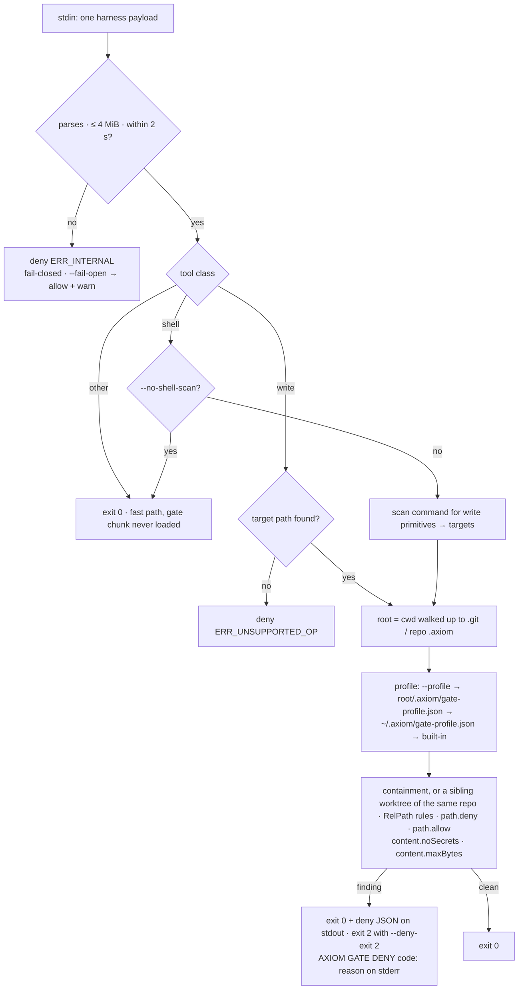

# Hook mode — `axiom gate --stdin`

*The fail-closed PreToolUse hook: what it checks, the per-harness output formats, the resident daemon, wiring for nine harnesses, steering to `axiom_write`, the decision journal, the profile file and the latency budget.*

`axiom gate` turns AXIOM's path and content rules into a **PreToolUse hook**: the harness calls it
before every tool call, the gate reads the payload from stdin and either lets the call through
(exit `0`, no output) or blocks it (exit `0` + a deny JSON document on stdout + reason on stderr;
`--deny-exit 2` for harnesses that read only the exit code). It is the cheap, always-on complement to the full
`Plan → check → apply` transaction: no manifest, no repo index, no guards, no git — just
"is this agent about to write somewhere it must not, or write something it must not".

Spec: [`design/v2-architecture.md`](../design/v2-architecture.md) §5.6. Implementation:
`packages/mcp/src/gate.ts`. Per-harness config snippets side by side:
[integration/harnesses.md](../integration/harnesses.md).



## What it checks

For every write target extracted from the tool call:

1. **Containment** — the target, after resolving against the root, must stay inside the root
   (`..\..\x`, absolute paths elsewhere → `ERR_CONTAINMENT`). Backslashes are treated as separators
   on every OS. Symlinks/junctions in the path are refused (`ERR_SYMLINK_IN_PATH`, via
  `@codai/axiom-apply`'s `resolveContained`). **Exception (2.4.1, D-35):** a target inside another
  *worktree of the same repository* — its nearest `.git` file points at
  `<common>/worktrees/<name>`, that directory's `gitdir` back-link points at this very file, and
  its `commondir` equals the root's git dir — is judged against **that worktree's** root and
  gate profile. Agents commonly work in leased worktrees (`E:\gh\.wt\<repo>\task-N`) while the
  harness cwd stays the main clone; 127 of 134 production denies in one week were exactly this.
  A worktree of a *different* repository, a plain directory, or a hand-made `.git` file without
  the back-link stays `ERR_CONTAINMENT`. No `git` process is spawned.
2. **`RelPath` rules** from `@codai/axiom-schema` — `CON`/`NUL`/`COM1…`
   (`ERR_PATH_RESERVED_NAME`), NTFS alternate data streams `file.txt:stream` and `<>:"|?*`
   (`ERR_PATH_INVALID_CHAR`), empty / `.` / trailing-dot segments (`ERR_PATH_SEGMENT`), non-NFC.
3. **`path.deny`** — picomatch globs from the profile (`dot: true`).
4. **`path.allow`** — when the profile has an `allow` list, every target must match one glob.
5. **`content.noSecrets`** — when the payload carries the new content (Claude `Write.content`,
   `Edit.new_string`, `MultiEdit.edits[].new_string`; Copilot `create_file.content`,
   `replace_string_in_file.newString`, `multi_replace_string_in_file.replacements[].newString`,
   `apply_patch` `+` lines), scan it with the same secret/PII patterns as the full check
   (AWS keys, GitHub tokens, private keys, JWTs, credential assignments, CNP, cards…).
6. **`content.maxBytes`** — when `maxBytes` is set in the profile.

The predicates are the real `@codai/axiom-checks` implementations, run against a hand-built
single-bundle `FactContext` (no digests, no JCS — the four predicates never read them). Tool calls
that are neither writes nor shell commands (`Read`, `grep_search`, `list_dir`, `create_directory`, …)
are allowed immediately without touching the filesystem.

### Tool classes (Gate v2, D-18)

| class | how recognised | what happens |
|---|---|---|
| **write** | name contains `write`, `edit`, `create_file`, `create`, `replace_string`, `replace`, `delete`, `insert_edit`, `apply_patch`, `notebook` (and is not `read`/`list`/`search`/`grep`/`glob`/`view`/`directory` — except `apply_patch`, `replace` and `delete`, which always count) | targets extracted from the recognised path keys / V4A headers and checked. **A write tool whose target cannot be determined is denied** (`ERR_UNSUPPORTED_OP`, "no recognised path key") — an unrecognised write is exactly what the gate exists to stop. `--fail-open` allows it with a warning instead. `replace` (Gemini, Cline `replace_in_file`) and `delete` (Cursor `Delete`) were unchecked before 2.5.0. |
| **shell** | name contains `bash`, `shell`, `terminal`, `run_in_terminal`, `execute_command`, `run_command`, `powershell`, `cmd` | the command string (`command`, `cmd`, `script`, `commandLine`) is scanned for **write primitives**; every path they would write or delete becomes a target. No command string → allow. `--no-shell-scan` allows every shell call. |
| **other** | everything else | allow, < 1 ms |

**Fast path (2.4.1).** Copilot CLI and VS Code have no matcher, so the hook fires on every tool
call and most of them are read-only. `cli.ts` reads stdin with a zero-dependency module
(`gate-fast.ts`, the single home of the hint lists above) and answers an **other**-class tool
with exit `0` before the gate chunk (zod + checks, ~290 KB) is loaded — exactly the case where the
full gate would allow without touching the filesystem. Anything else (no payload, invalid JSON, no
tool name, a write or shell tool) goes to the full gate with the already-read payload. Measured on
Windows: read-only call p50 207 → 141 ms (node's own start is ~140 ms).

**Shell scan** (a documented heuristic, not a shell parser — the Plan→apply path is the
guarantee, the gate is the seatbelt): redirections `>`, `>>`, `&>`, `N>` (not `/dev/*`, not
`2>&1`); `tee`, `rm`, `rmdir`, `unlink`, `mv`/`cp`/`ln`/`install` (destination = last operand),
`touch`, `truncate`, `mkdir`, `chmod`, `dd of=`, `sed -i` (files after the script);
`git checkout|restore|reset|rm|mv|stash` operands, `git clean` and `git reset --hard` (the whole
tree → denied whenever the profile has a `deny` list); PowerShell `Remove-Item`, `Set-Content`,
`Add-Content`, `Out-File`, `Move-Item`, `Copy-Item`, `New-Item` (`-Path`/`-LiteralPath`/
`-Destination`), `del`/`erase`/`move`/`copy`. Segments are split on `;`, `&&`, `||`, `|`;
`VAR=x`, `sudo`, `exec`, `nohup`, `time` prefixes are skipped; `$(…)`, `` `…` `` and `$VAR`
operands are opaque and produce no target. Operands that are not paths (URLs, globs, options)
are skipped rather than denied; an operand that *escapes the root* is still `ERR_CONTAINMENT`
(`cd` is not tracked, so `cd src && echo x >> ../.env` lands there too).

### Root discovery

The payload `cwd` is where the agent runs, not necessarily the repository root: VS Code and
Copilot start sub-agents in `apps/web`, and then `.git/**` or `.env` in the profile would never
match. Gate v2 walks up from `cwd` to the nearest ancestor holding `.git` (directory or worktree
file) or a *repository* `.axiom/` (one with `journal|cas|applied|profiles|trust|lock|backup` —
not `~/.axiom/`, which only carries a gate profile), never reaching the home directory or above.
Relative targets stay relative to `cwd`; the profile is loaded from the discovered root.
`--no-root-discovery` restores the 2.1 behaviour (`cwd` is the root).

## Exit-code and output contract

| outcome | exit | stdout | stderr |
|---|---|---|---|
| allow / non-write tool / payload without a tool name | `0` | nothing | nothing (`--log-level debug` explains) |
| deny | `0` (`2` with `--deny-exit 2`) | one JSON object, see below | `AXIOM GATE DENY <code>: <reason> (<relpath>)` |
| write tool with no recognised target | as deny | deny JSON | `AXIOM GATE DENY ERR_UNSUPPORTED_OP: … no recognised path key …` |
| malformed JSON, empty stdin, stdin > 4 MiB, stdin timeout (2 s), profile unreadable, any internal error | as deny — **fail closed** (D-18) | deny JSON | `AXIOM GATE DENY ERR_INTERNAL: <why> (fail-closed; pass --fail-open to allow)` |
| same, with `--fail-open` | `0` | nothing | `AXIOM GATE WARN: <why> — failing open (--fail-open)` |
| bad arguments / missing `--stdin` / `--deny-exit` not `0`/`2` | `2` | nothing | `AXIOM GATE ERROR: …` + usage |

### Output formats — `--format` (2.5.0, S-903)

The table above is `--format auto` (the default; Claude Code, Copilot CLI and VS Code read the same
document). Other harnesses read other shapes, so `axiom init` writes the right flag for each:

| `--format` | deny stdout | deny exit | allow stdout | once-per-session hint |
|---|---|---|---|---|
| `auto` · `claude` · `copilot` · `vscode` | combined document (below) | `0` | nothing | `{"hookSpecificOutput":{"hookEventName":"PreToolUse","additionalContext":…}}` |
| `codex` | `{"hookSpecificOutput":{…"permissionDecision":"deny",…}}` only | `0` | nothing | as `auto` |
| `cursor` | `{"permission":"deny","user_message":…,"agent_message":…}` | `0` | `{"permission":"allow"}` (Cursor's `failClosed` treats empty output as a failure) | `{"permission":"allow","agent_message":…}` |
| `windsurf` | nothing (Windsurf/Devin read only the exit code) | `2` | nothing | — |
| `gemini` · `junie` | `{"decision":"deny","reason":…}` | `0` | nothing | Junie as `auto`; Gemini — |
| `cline` | `{"cancel":true,"errorMessage":…}` (Cline ignores exit codes; usage errors print it too) | `0` | nothing | `{"cancel":false,"contextModification":…}` |

`--deny-exit 2` forces exit `2` in every format; the stderr line is the same everywhere.
Payload shapes recognised besides Claude/Copilot/VS Code: Cursor `preToolUse` (`tool_name`,
`tool_input`, `workspace_roots`) and `beforeShellExecution` (`command`, `cwd`); Windsurf/Devin
`{agent_action_name, tool_info}` (`pre_write_code` edits, `pre_run_command`, `pre_mcp_tool_use`);
Codex `apply_patch` (`tool_input.command` = the V4A patch); Gemini `write_file`/`replace`/
`run_shell_command`; Junie (Claude-like); Cline `{hookName, workspaceRoots, preToolUse:{toolName,
parameters}}` with JSON-stringified parameter values.

### Resident daemon — `axiom serve --hook` (2.5.0, S-901)

Every hook call used to start node and load the gate chunk. `axiom serve --hook --root <abs>…`
keeps the gate warm in one loopback process; `axiom gate --stdin` (the node `cli.js` and the SEA
binary) asks it first and **falls back to the in-process gate** whenever it gives no verdict —
no daemon, daemon down, another axiom version, a cwd outside its `--root` list, or a 1.5 s
timeout — so a missing daemon is slower, never a fail-open.

```text
axiom serve --hook --root E:\gh            # one daemon for every repo under E:\gh; Ctrl+C stops
```

- **Bind**: `127.0.0.1:47861` by default (`--host`, `--port`; a non-loopback host is refused).
  It writes `~/.axiom/daemon.json` (pid, port, roots, optional token; mode 0600) and removes it
  on clean shutdown. `AXIOM_GATE_DAEMON=0` makes clients ignore it.
- **Requests it refuses**: any `Origin` header or non-loopback `Host` (browser pages, DNS
  rebinding), a missing/wrong bearer token when started with `--token-env NAME`, a hook cwd /
  payload `cwd` / `--root` outside its roots (421 → the client decides in-process).
- **Same verdict**: the daemon runs the very same `gateMain` on the bytes the client read; a test
  asserts byte-identical stdout and exit codes for every format.
- **Clients**: the node `cli.js`; the native **`axiom-hook`** binary (Rust, std only, ~320 KB —
  release assets, brew, install.sh/ps1), which `axiom init --daemon` writes into every command
  hook (`axiom-hook gate --stdin --format X`; daemon down → it runs the installed `axiom` without a
  shell; neither → deny in the harness's format); and **Claude Code's `type: "http"` hook**,
  which needs no process at all:

```json
{ "matcher": "Write|Edit|MultiEdit|NotebookEdit",
  "hooks": [{ "type": "http", "url": "http://127.0.0.1:47861/v1/hook/claude", "timeout": 5, "onFailure": "block" }] }
```

  `onFailure: "block"` makes a stopped daemon block writes (Claude treats connection errors and
  non-2xx as failures), so start the daemon at login when you use it.

**Why a deny exits 0 (2.4.1, D-35).** Until 2.4.0 a deny exited `2`. On Windows the npm
`axiom.ps1` shim that PowerShell resolves for `axiom` rewrites every non-zero exit to `1`, and
VS Code treats exit `1` as a *non-blocking warning*: in one week of production logs (codai,
2026-10-07..14) **129 of 134 denies let the tool run**. Exit `0` with
`hookSpecificOutput.permissionDecision: "deny"` is honoured by VS Code, Claude Code, Copilot CLI,
Codex, Gemini CLI and Junie (contracts re-read 2026-10-14) and survives any shim. Windsurf blocks
only on exit `2` — use `--deny-exit 2` there (and on any harness without a JSON contract).

The deny document is **one** object that every consumer can read:

```json
{
  "hookSpecificOutput": { "hookEventName": "PreToolUse", "permissionDecision": "deny", "permissionDecisionReason": "AXIOM GATE DENY path.deny: … (.env)" },
  "permissionDecision": "deny",
  "permissionDecisionReason": "AXIOM GATE DENY path.deny: … (.env)",
  "axiom": { "verdict": "deny", "code": "path.deny", "path": ".env", "toolClass": "write", "standard": "owasp-acs/0.1" }
}
```

Claude Code reads `hookSpecificOutput` (the top-level `decision`/`reason` shape is deprecated
there); Copilot CLI and VS Code read the flat `permissionDecision` pair and merge it into their
own deny; `axiom.verdict` uses the OWASP Agent Control Standard v0.1 Guardian vocabulary
(`allow | deny | modify | ask | defer` — the gate emits only `allow`/`deny`) so logs and policy
tooling can consume it without knowing AXIOM. Unknown keys are ignored by every harness.

**Why fail closed?** (D-18) A gate that answers "allow" when it could not evaluate the call is not
a gate. Copilot CLI already treats a hook crash as a deny, so on that harness fail-closed costs
nothing; on Claude Code it turns an internal error into a visible block with a reason instead of a
silent pass. Harness *timeouts* still fail open — that is the harness's decision, and the reason
`npx` is banned in hooks (below). Use `--fail-open` where an editor must never be blocked by the
gate's own bugs; `--strict` (2.1) is accepted and ignored.

The stdout JSON is what JSON-aware harnesses act on; with `--deny-exit 2` the exit code carries
the decision too. The stderr line is what the model sees as the reason.

### Verified harness facts (2026-09-18)

- **Claude Code** (`code.claude.com/docs/en/hooks`, via Context7): stdin is
  `{session_id, transcript_path, cwd, permission_mode, hook_event_name: "PreToolUse", tool_name, tool_input, tool_use_id}`.
  Exit `2` blocks the tool call and feeds stderr to Claude; JSON on stdout with
  `hookSpecificOutput.permissionDecision: "deny"` + `permissionDecisionReason` is honoured even
  with exit `2` (since v2.1.214 a schema-invalid JSON with exit 2 still blocks). A **timed-out
  `command` hook does not block** — the call proceeds through the normal permission flow.
  `matcher` is a regex over tool names (`"Write|Edit|MultiEdit"`).
- **Copilot CLI** (`docs.github.com` → "GitHub Copilot hooks reference", web-verified): stdin is
  `{timestamp, cwd, toolName, toolArgs}` where **`toolArgs` is a JSON *string***; Copilot SDK
  callbacks see the same `toolName`/`toolArgs` in camelCase. For `preToolUse`, exit `2` (and any
  crash / non-zero exit) is a **deny**; stdout JSON `{permissionDecision, permissionDecisionReason}`
  is merged into the deny. **Command-hook timeouts always fail open**. Hook files are
  `.github/hooks/*.json` (repo) or `~/.copilot/hooks/*.json` (user), `{"version":1,"hooks":{"preToolUse":[…]}}`,
  entries `{"type":"command","bash":…,"powershell":…,"command":…}` or
  `{"type":"command","exec":…,"args":[…]}` — **`exec`/`args` is Copilot-CLI-only**, VS Code ignores
  such an entry entirely — plus `timeoutSec`. There is **no matcher** — the hook fires on every tool call and must filter on
  `toolName` itself (the gate does: non-write tools return in well under a millisecond).
- **VS Code agent hooks** (`code.visualstudio.com/docs/copilot/customization/hooks`, Preview):
  VS Code loads `.github/hooks/*.json` from the workspace **and** `.claude/settings.json`, plus user
  `~/.copilot/hooks` and `~/.claude/settings.json`. The Local harness reads only `command`,
  `windows`/`linux`/`osx`, or the Copilot `bash`/`powershell` fields (mapped to linux+osx/windows;
  `timeoutSec` → `timeout`, default 30 s). **An `exec`-only entry has no command for VS Code and is
  skipped without a warning** — axiom ≤ 2.5.1 wrote exactly that, and the gate ran 0 times in
  ~11k VS Code tool calls (2026-10-14). On Windows the command runs as
  `powershell.exe -ExecutionPolicy Bypass -NoProfile -NoLogo -Command …`: a bare `axiom` resolves to
  npm's `axiom.ps1`, and `-Command` turns every exit code except 0/1 into 1 — hence
  `axiom.cmd … ; exit $LASTEXITCODE`. Timeouts, launch failures and exit codes other than 0/2 are
  non-blocking warnings (fail-open). Workspace hook files need Workspace Trust and `chat.useHooks`
  (on by default); new files load on window reload. Observed 2026-08-31 in the house guard
  (`~/.copilot/hooks/guard-tooluse.ps1`): VS Code sends **`tool_name` / `tool_input`** (snake_case),
  while the CLI sends camelCase — reading only one casing silently failed open 790 times. The gate
  reads both.

## Wiring

**Install globally first** — `npm install -g @codai/axiom-mcp` (or `pnpm add -g`) — and call the
`axiom` bin. Do **not** put `npx -y @codai/axiom-mcp` in a hook: measured 2026-09-19 on Windows,
`npx` resolution alone is **p50 7.8 s / max 15 s even with a warm cache**, versus **p50 157 ms**
for the global bin and 124 ms for `node dist/cli.js`. Every harness kills a hook at its timeout
(5 s here) and then **fails open**, so an `npx` gate is a gate that never runs.

**Then let `axiom init` write the files.** It writes exactly the two shapes below — nothing else
in a hook file — and `axiom doctor` checks them afterwards:

| Harness | File `axiom init` writes | How |
|---|---|---|
| Copilot CLI · VS Code · Copilot cloud agent | `.github/hooks/axiom-gate.json` | whole file, exactly the JSON block below; an existing different file is `skipped (exists)` unless `--force` — except the exec-only file written by axiom ≤ 2.5.1, which is migrated automatically |
| Claude Code | `.claude/settings.json` | merged: the Claude entry below (matcher incl. `Bash\|PowerShell`, `onFailure: "block"`) is appended to `hooks.PreToolUse`; other keys and hooks are kept; an entry whose command already runs `axiom … gate` counts as present (`--force` replaces it); a file with comments (JSONC) is skipped, never rewritten |
| Cursor | `.cursor/hooks.json` + `.cursor/mcp.json` | `preToolUse` (`Write\|Delete\|Shell`) + `beforeShellExecution`, `--format cursor`, `failClosed: true` |
| Windsurf / Devin | `.devin/hooks.json` (if `.devin/` exists) else `.windsurf/hooks.json` | `pre_write_code` + `pre_run_command`, `--format windsurf` (exit 2); the Windows `powershell` field ends `; exit $LASTEXITCODE` — without it PowerShell turned exit 2 into 1 and no deny blocked |
| Codex | `.codex/hooks.json` + `.codex/config.toml` | `PreToolUse` matcher `^(Bash\|apply_patch\|Edit\|Write)$`, `--format codex` (`commandWindows` propagates the exit code); TOML `[mcp_servers.axiom]` appended only when absent |
| Gemini CLI | `.gemini/settings.json` | `hooks.BeforeTool` (`write_file\|replace\|run_shell_command`, timeout in ms) + `mcpServers.axiom` |
| Junie | `.junie/mcp/mcp.json` (+ `.junie/guidelines.md` section) | hooks run only from the user's `~/.junie/config.json` — `init` prints the snippet |
| Cline | `.clinerules/hooks/PreToolUse` (sh, 0755) + `PreToolUse.ps1` | both print a `cancel` document when `axiom` cannot run (Cline has no fail-closed); tick "Enable Hooks" |

Details and the exact snippets per harness: [integration/harnesses.md](../integration/harnesses.md).
`axiom init --daemon` writes the same files with `axiom-hook` (and the Claude HTTP hook) instead of `axiom`.

`axiom doctor` reports `hook.<harness>` as `ok` only when the file has an entry that runs
`axiom gate --stdin` / `axiom-hook gate --stdin` (or the Claude HTTP hook) **without** `npx` — an
`npx` entry is a `warn` because it will time out; a Cursor entry without `failClosed: true` is a
`warn`; an **exec-only** `.github/hooks/axiom-gate.json` is a `fail` (VS Code never runs it). It
also fails `hook.log.vscode` when VS Code's hook log shows ≥ 20 PreToolUse runs **for this
workspace** and none of them is the gate — proof the file is not being loaded. It checks the resident daemon (`daemon`: health, and whether this root is one of its
roots), the global bin against the gate profile (`bin.profile`: a profile using `steer`/`record`
with a global bin < 2.5.0 is a `fail` — the old strict schema denies every write), and reads VS
Code's own "GitHub Copilot Chat Hooks.log" (`hook.log.vscode`): gate runs that ended
`NonBlockingError` mean a deny there did **not** block (the 2026-10-14 audit, automated). It then spawns this CLI's gate 5 times with a benign `Write` payload
and reports the **p95** against the 5 s hook timeout: above **4000 ms** (80 % of the timeout) is a
`fail` (exit 2), since the harness would kill the hook and fail open; a benign write being denied
is a `warn` pointing at `gate-profile.json`.

### Copilot CLI / VS Code — `~/.copilot/hooks/axiom-gate.json` (user) or `.github/hooks/axiom-gate.json` (repo)

`axiom init` writes this file verbatim (repo scope):

```json
{
  "version": 1,
  "hooks": {
    "preToolUse": [
      {
        "type": "command",
        "command": "axiom gate --stdin --format auto",
        "bash": "axiom gate --stdin --format auto",
        "powershell": "axiom.cmd gate --stdin --format auto; exit $LASTEXITCODE",
        "timeoutSec": 15
      }
    ]
  }
}
```

One file serves VS Code (Local harness and Agent Host), Copilot CLI and the Linux cloud agent.
Do **not** use `exec`/`args`: only Copilot CLI honours it. `--daemon` writes the same entry with
`axiom-hook` / `axiom-hook.exe`.

### Claude Code — `.claude/settings.json` (project) or `~/.claude/settings.json`

`axiom init` merges this entry into the project file:

```json
{
  "hooks": {
    "PreToolUse": [
      {
        "matcher": "Write|Edit|MultiEdit|NotebookEdit",
        "hooks": [
          { "type": "command", "command": "axiom gate --stdin", "timeout": 5 }
        ]
      }
    ]
  }
}
```

`timeout` is in seconds. The matcher keeps the hook off `Read`/`Bash`; without it the gate still
answers `allow` for non-write tools in < 1 ms, so either is fine.

### Flags

| flag | meaning |
|---|---|
| `--stdin` | required; read one JSON payload from stdin |
| `--root <dir>` | root when the payload has no `cwd` (Copilot's `cwd` is always present; Claude's too) |
| `--profile <file>` | explicit profile; missing or invalid file is an internal error (deny, or allow with `--fail-open`) |
| `--fail-open` | internal errors, malformed payloads and undetermined write targets are allowed with a warning (2.1 behaviour) |
| `--no-shell-scan` | do not scan shell commands for write primitives |
| `--no-root-discovery` | treat the payload `cwd` as the root (do not walk up to `.git`/`.axiom`) |
| `--deny-exit 0\|2` | exit code for a deny (default `0`: the JSON decides; `2` for exit-code-only harnesses such as Windsurf) |
| `--format <f>` | output shape for the harness (table above); default `auto` |
| `--strict` | accepted for 2.1 hook configs; a no-op (fail-closed is the default) |
| `--log-level error\|warn\|info\|debug` | stderr verbosity (default `warn`; `debug` prints root/profile/class/targets) |

Root resolution order: payload `cwd` → root discovery (above) → `--root` → `process.cwd()`. **This
is the one place in AXIOM where the process cwd is acceptable**: both harnesses spawn the hook in
the project directory and put the same directory in the payload, so it is the harness's declared
root, not an accident of where the MCP server happened to be launched (the §(f) red-team pitfall).

## Profile file

Search order: `--profile <file>` → `<root>/.axiom/gate-profile.json` → `~/.axiom/gate-profile.json`
→ built-in default. First hit wins; files are not merged.

```json
{
  "deny": [".git/**", ".axiom/**", "**/*.lock", "pnpm-lock.yaml", ".env", ".env.*", "**/node_modules/**"],
  "allow": ["src/**", "docs/**"],
  "noSecrets": true,
  "pii": false,
  "maxBytes": 262144
}
```

| field | type | default | effect |
|---|---|---|---|
| `deny` | `string[]` | `[]` (built-in profile: the list above) | picomatch globs, `dot: true`; any match → `path.deny` |
| `allow` | `string[]?` | — | when present every target must match one glob → else `path.allow` |
| `noSecrets` | `boolean` | `true` | run `content.noSecrets` on supplied content → `content.noSecrets.<pattern>` |
| `pii` | `boolean` | `false` | also scan for personal data (`cnp`, `email`, `phoneRo`, `card`) — opt-in since S-414, see [checks.md](../guides/checks.md#contentnosecrets) |
| `maxBytes` | `number?` | — | run `content.maxBytes` on supplied content → `content.maxBytes` |
| `steer` | `"off"\|"hint"\|"require"` | `off` (`axiom init` writes `hint`) | `hint`: an allowed write gets a once-per-session `additionalContext` pointing at the `axiom_write` MCP tool (marker under `.axiom/hints/`); `require`: a direct write to `steerGlobs` is denied with `steer.requireApply` |
| `steerGlobs` | `string[]` | `[]` | globs `steer: "require"` routes through `axiom_write` (e.g. `migrations/**`, `CHANGELOG.md`) |
| `record` | `boolean` | `false` | append every judged write/shell call to `.axiom/decisions.jsonl` (JCS `args_hash`, decision, code, paths) — see below |

A gate profile that uses `steer`, `steerGlobs` or `record` needs axiom ≥ 2.5.0 on every machine
that runs the hook: older gates reject unknown keys and deny every write (`axiom doctor` checks).

### Steering writes to the transaction (S-905)

The gate is a seatbelt; the guarantee is `Plan → check → apply`. Agents skipped it because it
took four calls. 2.5.0 adds the MCP tool **`axiom_write`** (files in → preview with diff and
digest → the same files + `confirmDigest` → atomic apply, journal, one-step rollback) and the
profile's `steer` knob tells agents about it at the moment they write directly.

### Decision journal and attestations (S-906)

With `record: true`, each judged write/shell call appends one line to `.axiom/decisions.jsonl`:
`{v, decided_at, agent_id, principal, tool, args_hash, args_state, decision, code?, reason?, paths, profile}`
— the arguments are kept only as `sha256:` of their JCS (RFC 8785) form. `axiom attest decisions
[--since <iso>] [--sign]` turns them into in-toto Statement v1 documents with predicateType
`https://auxidus.dev/attestation/agent-decision/v0.1` ([in-toto/attestation#554](https://github.com/in-toto/attestation/issues/554);
DSSE-signed with the repo key under `--sign`). Mapping to the OWASP Agent Control Standard:
[concepts/trust-model.md](../concepts/trust-model.md#owasp-agent-control-standard).

The object is strict (unknown keys are a schema error → deny `ERR_INTERNAL`, or warn + allow with `--fail-open`).
Deny codes in the stderr line are either an `ERR_*` from the closed `ERROR_CODES` enum
(containment / path rules) or the predicate finding id (`path.deny`, `content.noSecrets.awsKey`, …).

## Latency budget

Target: **< 120 ms in-process** per payload (§5.6), **p95 ≤ 250 ms end-to-end** including node
startup (`scripts/check-gate-latency.mjs`, 15 runs, allowed payload, skipped when `dist` is absent).

Measured 2026-09-18 on the reference Windows box (Node 26.1): in-process p50 1.8 ms / p95 5.5 ms /
max 54 ms over 1000 mixed payloads; end-to-end p50 150–194 ms / p95 191–342 ms over 30 spawns
(node startup dominates; `--version` cold start on the same box is ~100 ms).

Re-measured 2026-09-20 after Gate v2 (shell scan + root discovery + fail-closed), same box:
`node scripts/check-gate-latency.mjs` end-to-end **p50 89 ms / p95 104 ms / max 104 ms** over
15 spawns (allowed Write); `dist/gate-lazy.js` 283 KB, still without the MCP SDK. The shell scan
is regex over the command string and root discovery is at most a handful of `lstat`s, so neither
shows up above node startup.

Why the budget matters: both harnesses fail **open** on a hook timeout, so a slow gate is not a
strict gate — it is a gate that is silently skipped whenever the machine is busy. That is why the
hook runs no repo index, no guards and no git, and why `gate` is its own lazy chunk
(`dist/gate-lazy.js`, ~300 KB, no MCP SDK) reached straight from the thin `cli.js` entry — loading
the server code would add the SDK + zod + all engines (~950 KB) to every tool call.

To measure it on *your* machine, under your antivirus and load: `axiom doctor` (check
`gate.latency`, p95 of 5 spawns, fails above 4000 ms).

**2.5.0 — daemon (S-901).** Interleaved A/B on the reference box, allowed `Write` payload, CPU
at 45–79 % from other agents (`.copilot-tmp/p9/ab-daemon.mjs`): the daemon's own decision as a
Claude HTTP hook (no process spawn) **p50 4.1–5.1 ms / p90 5.1–6.9 ms**. Every spawned client —
2.4.1, 2.5.0 in-process, 2.5.0 via the daemon, `axiom-hook` — measured p50 244–394 ms with
p90 0.6–2.9 s, i.e. the load noise was larger than any difference between them; the process
start itself (node 60–77 ms, a native exe 30–33 ms, an unsigned exe ~140 ms under Defender) is
the floor a spawn harness cannot go below. **< 20 ms per call is reached only without a spawn**
(Claude HTTP hook); on spawn harnesses the daemon removes the gate-chunk load, not the process start.

## Limitations

- The gate sees what the harness sends. A write tool whose path is not in a recognised key
  (`file_path`, `filePath`, `path`, `notebook_path`, `target_file`, `uri`, …) is **denied**
  (`ERR_UNSUPPORTED_OP`) — add the key to `PATH_KEYS`/`WRITE_TOOL_HINTS` in `gate.ts`, or run with
  `--fail-open`, rather than widening the profile. A tool whose *name* does not look like a write
  or a shell at all is still allowed.
- `Edit`/`replace_string_in_file` carry only the replacement text, so `noSecrets` scans the new
  string, not the resulting file.
- The shell scan is a heuristic over the command text: it does not follow `cd`, aliases,
  functions, scripts it invokes, `xargs`, `find -delete`, `python -c "open(…,'w')"`, or paths
  produced by substitution. Pair it with a command guard (the house `guard-tooluse.ps1`) where
  shell writes matter, and rely on `Plan → check → apply` for the guarantee.
- Root discovery stops at `.git`/repo-`.axiom`; a repository without either uses `cwd` as root, so
  `.git/**`-style globs cannot match anything there anyway.

---

**See also**

- [Harnesses](../integration/harnesses.md) — Claude Code / Copilot CLI / VS Code / Codex config matrix
- [Install](install.md) — why hooks need the global bin, not `npx`
- [Checks](../guides/checks.md) — the full predicates the gate borrows four of
- [Trust model](../concepts/trust-model.md) — the gate as seatbelt, `Plan → apply` as the guarantee
