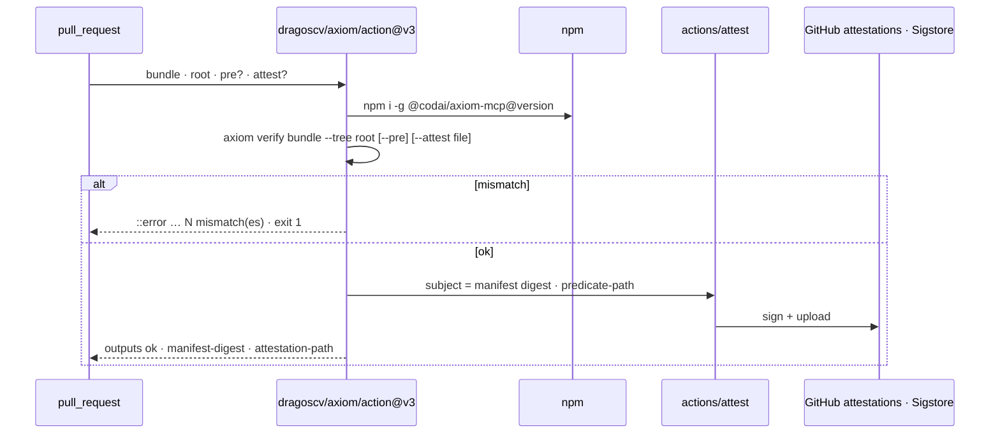

# GitHub Action — `dragoscv/axiom/action`

*Fail a pull request whose tree does not match an AXIOM manifest, optionally upload an in-toto attestation and post one sticky PR summary comment. Inputs, outputs, permissions, the `@v3` moving tag.*

The composite action in [`action/action.yml`](../../action/action.yml) installs `@codai/axiom-mcp`
on the runner, runs `axiom verify <bundle> --tree <root>` and, with `attest: true`, hands the
resulting predicate to `actions/attest` so `gh attestation verify` can later prove which tree a
manifest was verified against. It runs on ubuntu, macos and windows runners (`shell: bash`).



## Usage

```yaml
# .github/workflows/axiom-verify.yml
name: axiom verify
on: pull_request
permissions:
  contents: read
  id-token: write        # only for attest: true
  attestations: write    # only for attest: true
jobs:
  verify:
    runs-on: ubuntu-latest
    steps:
      - uses: actions/checkout@v5
      - uses: dragoscv/axiom/action@v3
        id: axiom
        with:
          bundle: .axiom/manifests/<hex>.json   # the bundle the agent applied
          root: .
          # pre: true                            # verify the pre-image set instead
          # attest: true                         # upload an attestation on success
      - run: echo "verified ${{ steps.axiom.outputs.manifest-digest }}"
```

Where does the bundle come from? Whatever compiled it stored a copy under
`<root>/.axiom/manifests/<hex>.json` when a root was given; commit that file (or upload it as an
artifact from the job that ran the agent) so the PR carries the manifest it claims to implement.

## Inputs

| Input | Required | Default | Meaning |
|---|---|---|---|
| `bundle` | yes | — | path to the `ManifestBundle` JSON (output of `axiom compile`) |
| `root` | no | `.` | tree to verify against |
| `pre` | no | `false` | verify the manifest's declared **pre-image** set (`ManifestBody.preImage`) instead of the post-apply artifacts — "is this the tree it was compiled against?" |
| `attest` | no | `false` | write an in-toto Statement and upload it via `actions/attest` (needs `id-token: write`, `attestations: write`) |
| `attestation-path` | no | `axiom-attestation.intoto.json` | where the Statement is written when `attest` is true; the bare predicate goes beside it |
| `version` | no | `3` | `@codai/axiom-mcp` npm dist-tag or exact version to `npm i -g` |
| `local-cli` | no | `""` | path to a built `cli.js` to use instead of npm — dogfooding inside the AXIOM repo's own CI; consumers leave it empty |
| `check-profile` | no | `""` | profile for the SARIF `axiom check` run (`--profile`); empty = the manifest's profile |
| `sarif` | no | `""` | when set, also run `axiom check <bundle> --root <root> --format sarif`, write the log to this path and upload it to code scanning (needs `security-events: write`) |
| `pr-comment` | no | `false` | on a `pull_request` event, post or update ONE sticky PR comment summarising the run — see [PR summary comment](#pr-summary-comment) (needs `pull-requests: write`) |
| `github-token` | no | `${{ github.token }}` | token `pr-comment` uses to list the PR's files and write the comment |

## Outputs

| Output | Meaning |
|---|---|
| `ok` | `true` when every path matched |
| `manifest-digest` | the `manifestDigest` that was verified (`sha256:…`) |
| `mismatches` | number of paths that did not match |
| `attestation-path` | path of the written Statement (empty unless `attest: true` and `ok`) |
| `sarif-path` | path of the written SARIF log (empty unless `sarif` is set and a log was produced) |
| `comment-url` | URL of the sticky PR comment (empty unless `pr-comment: true` wrote one) |

The full `verify --tree` JSON (`{ ok, manifestDigest, canonical, root, tree, paths, mismatches[] }`)
is printed to the job log. A mismatch fails the step with an `::error` annotation naming the digest
and the count; exit code is the CLI's (`1` mismatch, `2` structural).

## Scope of the check (D-20)

Only the manifest's own paths are compared: every `create`/`overwrite` artifact must be present
with its declared digest, every `delete` must be absent. Files the manifest never mentioned are
ignored, so the check survives unrelated commits on the branch. A whole-root digest was rejected
for exactly that reason. With `pre: true` the expected set is `preImage[]` instead.

## SARIF and code scanning

With `sarif: <path>` the action runs `axiom check <bundle> --root <root> --format sarif
[--profile <check-profile>]` after the verify step — also when verify failed, so code scanning
sees the findings of a bad PR — and uploads the log with `github/codeql-action/upload-sarif`
(pinned to a commit SHA, `# v4.38.3`, category `axiom`). Check exit `1` (findings) still uploads;
no parsable SARIF log fails the step. Mapping details: [SARIF guide](../guides/sarif.md).

```yaml
permissions:
  contents: read
  security-events: write   # required by upload-sarif
jobs:
  axiom:
    runs-on: ubuntu-latest
    steps:
      - uses: actions/checkout@v5
      - uses: dragoscv/axiom/action@v2
        with:
          bundle: .axiom/manifests/<hex>.json
          sarif: axiom.sarif
          check-profile: strict
```

Pull requests from forks get a read-only token; `upload-sarif` then fails with `Resource not
accessible by integration` — run the SARIF job on `pull_request_target` only if you understand
the security trade-off, or upload from a follow-up `workflow_run`.

## PR summary comment

With `pr-comment: true` on a `pull_request` event the action keeps exactly **one** comment on
the PR up to date (it finds its own by the hidden marker `<!-- axiom-pr-summary -->` and edits
it on every push instead of adding a new one). The comment lists:

| Row | Source |
|---|---|
| verify-tree | the `axiom verify --tree` JSON of this run: match/mismatch, digest, the paths that differ |
| checks | `axiom plan check <bundle> --root <root> --format json` (run only for the comment; it never fails the job): verdict, profile, findings per severity, the first 20 `error`/`warn` findings |
| changed files covered by a manifest | every file in the PR (`GET /pulls/{n}/files`) classified as **agent-applied** (an artifact of the verified bundle, of any committed `.axiom/manifests/*.json` bundle or of a committed `.axiom/applied/*.json` marker), **gated by the hook but not in a manifest** (an `allow` line of a committed `.axiom/decisions.jsonl`), **not covered**, or **outside the verified root** |
| decision journal | allow · deny · ask counts, when `.axiom/decisions.jsonl` is committed |
| attestation | link to the in-toto statement uploaded by `attest: true` (the `actions/attest` `attestation-url` output) |

Most repositories commit neither `.axiom/applied/` nor `decisions.jsonl` (both are local state);
the coverage then comes from the bundle the action verified plus any bundles under
`.axiom/manifests/` — commit those, as recommended above, and the split is exact. "Covered"
means *the path is an artifact of a manifest*; it says nothing about files a manifest never
mentions (D-20).

```yaml
# .github/workflows/axiom-pr.yml
name: axiom pr summary
on: pull_request
permissions:
  contents: read
  pull-requests: write     # the sticky comment
  id-token: write          # attest: true
  attestations: write      # attest: true
jobs:
  axiom:
    runs-on: ubuntu-latest
    steps:
      - uses: actions/checkout@v5
      - uses: dragoscv/axiom/action@v3
        with:
          bundle: .axiom/manifests/<hex>.json
          attest: true
          pr-comment: true
```

The step is implemented by [`action/pr-comment.mjs`](../../action/pr-comment.mjs) — Node ≥ 22,
no dependencies, GitHub REST via `fetch`; the token is only ever sent in the `Authorization`
header and never printed. It runs also when verify failed (`always()`), and it never fails the
job: without `pull-requests: write`, or on a fork PR (read-only `GITHUB_TOKEN`), it emits a
`::warning` and exits 0. To comment on fork PRs, run the action from a `workflow_run` workflow
with its own token rather than switching to `pull_request_target` on untrusted code.

Preview the body locally (no API call):

```sh
AXIOM_BUNDLE=bundle.json AXIOM_ROOT=. AXIOM_VERIFY_JSON=verify.json \
AXIOM_PR_FILES=$'src/a.ts\nsrc/b.ts' node action/pr-comment.mjs --dry-run
```

## Attestation (D-21)

With `attest: true` and a match, the action calls `actions/attest` with

- `subject-name` = the plan name, `subject-digest` = the **manifest digest** — not the sha256 of
  any file on disk;
- `predicate-type` = `https://dragoscv.github.io/axiom/spec/attestation/apply/v1`;
- `predicate-path` = the sibling `.predicate.json` (`{ manifest, plan, profile, tree, paths[],
  preImage?[], verifier, source }`, no clock; `source` carries `GITHUB_REPOSITORY/REF/SHA/RUN_ID`).

Verify it later by subject digest — the digest is in `.axiom/applied/<hex>.json`, any
`CheckReport`, or the action's output:

```sh
gh api repos/<owner>/<repo>/attestations/sha256:<manifest hex> \
  --jq '.attestations[].bundle.dsseEnvelope.payload' | base64 -d \
  | jq '.predicateType, .subject, .predicate.tree, .predicate.source'
```

For a full Sigstore verification with `gh attestation verify`, give it a file whose sha256 *is*
the manifest digest — the JCS bytes of `bundle.manifest` — as shown in
[verify-tree.md](../guides/verify-tree.md#attestation-d-21).

> [!NOTE]
> This attestation says *a tree was checked against this manifest, by this workflow, on this
> commit*. It is a different proof from a DSSE signature on the bundle
> ([signing.md](../guides/signing.md)), which says *who produced the manifest*. Use both when you
> need both.

## Versioning of the action — `@v3`

`@v3` is a **moving tag**: `release.yml` (job `action-tag`) moves `v<major>` to a release only
when that release is the highest `v<major>.x.y` tag (`git tag -l 'v3.*' --sort=-v:refname`), so a
late hotfix of an older minor never drags it backwards, and prereleases never move it (D-31,
S-1322). Each major has its own tag: 3.x releases never touch `@v2`, which stays on the last
2.x release (2.7.x patches still move it). `@v3` installs `@codai/axiom-mcp@3` by default. For a
reproducible pin use a full tag (`@v3.0.0`) or a commit SHA, and pin `version:` to an exact npm
version as well:

```yaml
- uses: dragoscv/axiom/action@<sha>   # v3.0.0
  with:
    bundle: .axiom/manifests/<hex>.json
    version: 3.0.0
```

The inner `actions/attest` and `github/codeql-action/upload-sarif` steps are themselves pinned to
SHAs (`# v4`, `# v4.38.3`) and checked by the repository's `check-action-pins` guard.

## Failure modes

| Symptom | Cause | Fix |
|---|---|---|
| `bundle failed structural verification; tree not checked` | the bundle is not self-consistent (digest ≠ recomputed, blob mismatch) | re-run `axiom compile`; a hand-edited bundle can never pass |
| `mismatches: [{ path, expected, actual }]` with `actual` a sha | someone edited the file after the apply | intended — that is the check |
| `actual: "ERR_SYMLINK_IN_PATH"` / `"non-file:dir"` | a symlink, directory or containment escape where a file is expected | inspect the path; a manifest never creates those |
| `--pre is asked of a manifest that carries no preImage` | the bundle was compiled without a root | compile with `--root` (the MCP tool does when given `root`) |
| attest step skipped | `ok` was not `true`, or `attest` not `"true"` | the attestation is only ever uploaded for a matching tree |
| `Resource not accessible by integration` on attest | missing `id-token: write` / `attestations: write` | add the permissions block |
| `Resource not accessible by integration` on upload-sarif | missing `security-events: write`, or a fork PR token | add the permission; see [SARIF and code scanning](#sarif-and-code-scanning) |
| `no SARIF log produced` | the CLI predates `--format sarif` or failed structurally | pin `version:` to ≥ 2.6.0; read the step log |
| `::warning title=AXIOM PR comment::cannot write the comment (… HTTP 403)` | no `pull-requests: write`, or a fork PR's read-only token | add the permission; for forks see [PR summary comment](#pr-summary-comment) |
| PR comment shows every file as "not covered" | the bundle and `.axiom/manifests/` are not committed in the PR | commit the bundle the agent applied |

## Dogfooding in this repository

`ci.yml` job `verify-action` runs the action with `local-cli` against a scratch tree on every
push: it must pass on the applied tree, fail with exactly one mismatch after a hand edit,
render the PR comment body in `--dry-run` (marker, mismatch, one covered and one uncovered
file), and upload an attestation on `main`. The first live attestation
(`dragoscv/axiom` run 35476782913, 2026-09-20) was fetched and decoded with the command above.

---

**See also**

- [Verify tree](../guides/verify-tree.md) — the CLI verb behind the action, scope and attestation details
- [Signing](../guides/signing.md) — the other proof: DSSE over the manifest
- [Install](../getting-started/install.md#github-action) — the action among the other channels
- [Trust model](../concepts/trust-model.md#5-attestation-proof-that-outlives-the-agent) — why attestation is the last boundary
