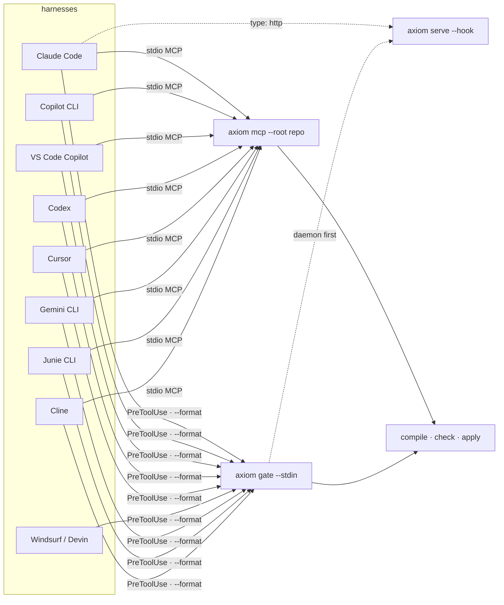

# Harnesses: Claude Code, Copilot CLI, VS Code, Codex, Cursor, Windsurf, Gemini CLI, Junie, Cline

*One matrix for wiring AXIOM into each coding-agent harness — the MCP server config and the PreToolUse hook — with the per-harness facts that decide the shape.*

Every harness gets the same two things: an **MCP server** entry so the agent can run
`Plan → compile → check → dry-run → apply`, and a **PreToolUse hook** so the harness's own write
tools are gated. The MCP entry is nearly identical everywhere; the hook differs in file location,
payload casing, matcher support and timeout behaviour. [hooks.md](../getting-started/hooks.md)
is the deep reference for the gate; this page is the copy-paste matrix.



## Prerequisites

- `npm i -g @codai/axiom-mcp` — the global `axiom` bin is **required** for hooks (measured
  `npx` p50 7.8 s vs 157 ms; every harness fails **open** on hook timeout, so an `npx` gate never
  runs). The MCP server may use `npx -y` because it starts once.
- A repository root. Every server entry passes it explicitly with `--root`; there is no `cwd`
  fallback. Repeat `--root` for several repositories.
- Optional: `.axiom/gate-profile.json` and `.axiom/profiles/<name>.json` in the repo
  ([profiles.md](../reference/profiles.md)).

## `axiom init` does the repo-level wiring

Run `axiom init` in the repository root (`--harness auto|copilot|claude|codex|vscode|cursor|windsurf|gemini|junie|cline`,
default `auto` = one harness per marker directory `.github` / `.claude` / `.codex` / `.vscode` /
`.cursor` / `.windsurf` or `.devin` / `.gemini` / `.junie` / `.clinerules`, none → copilot +
vscode). It writes the **repo-scoped** files of this matrix, never the user-level ones
(`~/.claude.json`, `~/.copilot/mcp-config.json`, `~/.codex/config.toml`, `~/.junie/config.json`,
Devin's `mcp_config.json`):

| Harness | Hook | MCP entry |
|---|---|---|
| Claude Code | `.claude/settings.json` — the `PreToolUse` entry from [§ Claude Code](#claude-code) merged in | `.vscode/mcp.json` (add `.mcp.json` by hand for the Claude CLI) |
| Copilot CLI | `.github/hooks/axiom-gate.json` — the `command`/`bash`/`powershell` file from [§ Copilot CLI](#copilot-cli) | `.vscode/mcp.json` (the CLI reads `~/.copilot/mcp-config.json`; add it there by hand) |
| VS Code | `.github/hooks/axiom-gate.json` (same file — VS Code ignores `exec`-only entries) | `.vscode/mcp.json` — `servers.axiom` merged in, `npx -y @codai/axiom-mcp@2 mcp --root ${workspaceFolder}` |
| Codex | `.codex/hooks.json` — `PreToolUse` merged in ([§ Codex](#codex)) | `.codex/config.toml` — `[mcp_servers.axiom]` appended only when absent |
| Cursor | `.cursor/hooks.json` — `preToolUse` + `beforeShellExecution`, `failClosed: true` | `.cursor/mcp.json` |
| Windsurf / Devin | `.devin/hooks.json` (if `.devin/` exists) else `.windsurf/hooks.json` | user-level only — a note |
| Gemini CLI | `.gemini/settings.json` — `hooks.BeforeTool` merged in | same file, `mcpServers.axiom` |
| Junie | none in the project (Junie CLI runs hooks only from `~/.junie/config.json`) — a note with the snippet | `.junie/mcp/mcp.json` (+ an AXIOM section in `.junie/guidelines.md`) |
| Cline | `.clinerules/hooks/PreToolUse` (sh, 0755) + `PreToolUse.ps1` | none — Cline's MCP settings are user-level (a note) |

Plus, for every harness, `.axiom/profiles/<repo-name>.json`, `.axiom/gate-profile.json` (with
`"steer": "hint"` since 2.5.0 — allowed writes get a once-per-session pointer to `axiom_write`) and the
`.gitignore` lines. JSON files are merged, never overwritten without `--force`; JSONC is skipped
with a note; TOML and Markdown are only ever appended to. Then `axiom doctor` confirms the hook
files run `axiom gate --stdin` / `axiom-hook gate --stdin` (not `npx`),
that the global bin is on `PATH` at the same version, and that the gate's **p95 latency** over
5 spawns is under 4000 ms — 80 % of the 5 s timeout after which every harness below fails open.
Exit `2` means a check failed.

**`axiom init --daemon`** writes the same files for the resident gate daemon
(`axiom serve --hook --root <parent dir>`, [hooks.md § Resident daemon](../getting-started/hooks.md#resident-daemon--axiom-serve---hook-250-s-901)):
Claude Code gets a `type: "http"` hook (`onFailure: "block"`) — no process per call — and every
command hook runs the native `axiom-hook` client, which falls back to the installed `axiom` when
the daemon is down and denies in the harness's format when neither can run.

## Matrix

| | Claude Code | Copilot CLI | VS Code (Copilot agent) | Codex |
|---|---|---|---|---|
| MCP config file | `.mcp.json` (project) / `~/.claude.json` | `~/.copilot/mcp-config.json` or `copilot mcp add` | `.vscode/mcp.json` | `~/.codex/config.toml` |
| MCP entry shape | `mcpServers.axiom { command, args }` | `mcpServers.axiom { type: "local", command, args, tools }` | `servers.axiom { type: "stdio", command, args }` | `[mcp_servers.axiom] command, args` |
| Hook file | `.claude/settings.json` (project) / `~/.claude/settings.json` | `.github/hooks/*.json` (repo) / `~/.copilot/hooks/*.json` | `.github/hooks/*.json` **and** `.claude/settings.json` (both loaded) | none — no hook API |
| Hook event | `PreToolUse` with regex `matcher` | `preToolUse`, **no matcher** (fires on every tool; the gate filters in < 1 ms) | `PreToolUse`, `{ type: "command", command, timeoutSec }` | — |
| Payload | `{ session_id, cwd, hook_event_name, tool_name, tool_input, tool_use_id }` | `{ timestamp, cwd, toolName, toolArgs }` — **`toolArgs` is a JSON string** | `tool_name` / `tool_input` (snake_case, unlike the CLI) | — |
| Deny signal read | stdout `hookSpecificOutput.permissionDecision` (exit `0`), or exit `2` | stdout `permissionDecision` (exit `0`); any non-zero / crash = deny | stdout JSON deny on exit `0`, or exit `2`; **exit `1` is only a warning** | — |
| Hook timeout → | proceeds through normal permission flow (**fail open**) | **fail open** | **fail open** | — |
| Per-tool auto-approve | `permissions.allow: ["mcp__axiom__axiom_apply"]` | `--allow-tool 'axiom(axiom_apply)'` | `chat.tools.global.autoApprove` / UI | `[mcp_servers.axiom.tools.axiom_apply] approval_mode` |
| Tool that forces a prompt | `_meta["anthropic/requiresUserInteraction"]` honoured — set on `axiom_apply` / `axiom_write` since 2.6.0, a hook `allow` cannot skip it; `destructiveHint` | `destructiveHint` | `destructiveHint` → confirm dialog | approval policy |
| Human confirm step ([S-1206](../guides/human-confirm.md)) | MCP elicitation form (digest + typed `digest12`) — supported (`Elicitation` / `ElicitationResult` hooks exist; `axiom doctor` fails if one is configured) | elicitation form when the client declares the capability, else the confirmDigest echo (`--require-human` refuses) | same rule; `chat.tools.global.autoApprove: true` → `axiom doctor` warns | same rule |

The gate emits **one** deny document that every column reads
(`hookSpecificOutput{…}` + flat `permissionDecision` + `axiom{ verdict, code, path, toolClass }`),
and reads both payload casings, so a single hook config serves whichever harness loads it. Since
2.4.1 a deny exits `0` with that document (D-35): on Windows the npm `axiom.ps1` shim turns exit
`2` into `1`, and VS Code lets the tool run on `1`. Harnesses that read only the exit code
need `--deny-exit 2`; since 2.5.0 the harnesses below get their own `--format`.

### Five more harnesses (2.5.0, verified 2026-10-14)

| | Cursor | Windsurf / Devin Cascade | Gemini CLI | Junie (CLI) | Cline (VS Code) |
|---|---|---|---|---|---|
| Hook file | `.cursor/hooks.json` (+ user `~/.cursor/hooks.json`, enterprise) | `.devin/hooks.json` (legacy `.windsurf/hooks.json`), user `~/.codeium/windsurf/hooks.json` | `.gemini/settings.json` (+ user, system) | `~/.junie/config.json` only (project hooks ignored by default; the IDE plugin runs none) | `.clinerules/hooks/PreToolUse` (+ `.ps1` on Windows), global `~/Documents/Cline/Hooks/` |
| Event | `preToolUse` (matcher `Write\|Delete\|Shell`) + `beforeShellExecution` | `pre_write_code`, `pre_run_command` (no matcher) | `BeforeTool`, regex matcher on tool name | `PreToolUse`, matcher = tool name | executable named after the event |
| Deny contract read | `{"permission":"deny"}` or exit 2 | **exit 2 only** | `{"decision":"deny"}` or exit 2; non-JSON stdout = allow | `{"decision":"deny"}` or exit 2; invalid JSON = allow | `{"cancel":true}` — **exit code ignored** |
| Fail-closed option | `failClosed: true` per hook (init sets it) | none — the gate itself exits 2 | none | none for PreToolUse | none — init's scripts print a cancel when `axiom` cannot run |
| Timeout unit | seconds | not configurable | **milliseconds** | seconds | fixed 30 s |
| `--format` | `cursor` (allow prints `{"permission":"allow"}`) | `windsurf` | `gemini` | `junie` | `cline` |
| Note | Cursor also runs Claude hooks from `.claude/settings.json` by default → with both wired the gate runs twice (harmless) | hooks do not load in Restricted Mode | project hooks are fingerprinted; a changed command warns | — | tick **Enable Hooks** in Cline's settings |

## Claude Code

**MCP** — `.mcp.json` in the project (or `claude mcp add axiom -- npx -y @codai/axiom-mcp mcp --root /abs/repo`):

```json
{
  "mcpServers": {
    "axiom": {
      "command": "npx",
      "args": ["-y", "@codai/axiom-mcp", "mcp", "--root", "/abs/path/to/repo"]
    }
  }
}
```

**Hook** — `.claude/settings.json` (project) or `~/.claude/settings.json`:

```json
{
  "hooks": {
    "PreToolUse": [
      {
        "matcher": "Write|Edit|MultiEdit|NotebookEdit",
        "hooks": [
          { "type": "command", "command": "axiom gate --stdin", "timeout": 5 }
        ]
      }
    ]
  }
}
```

`timeout` is in seconds. The matcher keeps the hook off `Read`; drop `Bash` in on purpose if you
want the shell scan (`"matcher": "Write|Edit|MultiEdit|NotebookEdit|Bash"`). Claude reads
`hookSpecificOutput` (the top-level `decision`/`reason` shape is deprecated); since v2.1.214 an
exit `2` with schema-invalid JSON still blocks. A timed-out hook does **not** block.

**Auto-approve the read-only tools, keep the prompt on apply:**

```json
{ "permissions": { "allow": [
  "mcp__axiom__axiom_plan_compile", "mcp__axiom__axiom_check",
  "mcp__axiom__axiom_apply_dry_run", "mcp__axiom__axiom_manifest_verify" ] } }
```

## Copilot CLI

**MCP** — `~/.copilot/mcp-config.json` (or `copilot mcp add`):

```json
{
  "mcpServers": {
    "axiom": {
      "type": "local",
      "command": "npx",
      "args": ["-y", "@codai/axiom-mcp", "mcp", "--root", "/abs/path/to/repo"],
      "tools": ["*"]
    }
  }
}
```

**Hook** — `.github/hooks/axiom-gate.json` (repo) or `~/.copilot/hooks/axiom-gate.json` (user):

```json
{
  "version": 1,
  "hooks": {
    "preToolUse": [
      {
        "type": "command",
        "command": "axiom gate --stdin --format auto",
        "bash": "axiom gate --stdin --format auto",
        "powershell": "axiom.cmd gate --stdin --format auto; exit $LASTEXITCODE",
        "timeoutSec": 15
      }
    ]
  }
}
```

`exec`/`args` also works in Copilot CLI but makes VS Code skip the entry silently, so `init`
(≥ 2.5.2) never writes it and migrates the old exec-only file.
There is **no matcher** — the hook fires on every tool call and must be cheap for non-writes (the
gate returns in well under a millisecond for `grep_search`, `list_dir`, …). `toolArgs` arrives as
a JSON *string*; the gate parses it. Any non-zero exit or crash is a deny, so fail-closed costs
nothing here; a **timeout** still fails open.

**Per-tool approval:** `copilot --allow-tool 'axiom(axiom_plan_compile)' --allow-tool 'axiom(axiom_check)'`
and leave `axiom_apply` to prompt. The Copilot SDK sees the same `toolName`/`toolArgs` in its
callbacks.

## VS Code (Copilot agent mode)

**MCP** — `.vscode/mcp.json`:

```json
{
  "servers": {
    "axiom": {
      "type": "stdio",
      "command": "npx",
      "args": ["-y", "@codai/axiom-mcp", "mcp", "--root", "${workspaceFolder}"]
    }
  }
}
```

**Hook** — VS Code loads `.github/hooks/*.json` from the workspace **and** `.claude/settings.json`,
plus the user-level `~/.copilot/hooks` and `~/.claude/settings.json`, so the Copilot file above
works unchanged (`powershell` maps to Windows, `bash` to Linux/macOS, `command` is the fallback).
On Windows VS Code runs it through `powershell.exe -Command`, which is why the entry calls
`axiom.cmd` and ends `; exit $LASTEXITCODE` (otherwise exit 2 becomes 1, a non-blocking warning).
Observed 2026-08-31: VS Code sends **`tool_name` / `tool_input`** (snake_case) while the CLI sends
camelCase — a hook that read only one casing silently failed open 790 times; the gate reads both.
Sub-agents start in sub-directories (`apps/web`); the gate walks up to the repository root so
`.git/**` and `.env` rules still match.

The `.axm` extension, HTTP transport and a full workspace layout: [vscode.md](vscode.md).

## Codex

**MCP** — `~/.codex/config.toml`:

```toml
[mcp_servers.axiom]
command = "npx"
args = ["-y", "@codai/axiom-mcp", "mcp", "--root", "/abs/path/to/repo"]

[mcp_servers.axiom.tools.axiom_apply]
approval_mode = "always"        # keep the human on the destructive tool
```

`axiom init --harness codex` appends this table to the project `.codex/config.toml` (with
`--root .`) only when it has no `[mcp_servers.axiom]` yet.

**Hook** (Codex hooks, 2026; `.codex/hooks.json` or `[hooks]` in `config.toml`, user or trusted
project; each new or changed hook must be reviewed once with `/hooks`):

```json
{ "hooks": { "PreToolUse": [ { "matcher": "^(Bash|apply_patch|Edit|Write)$",
  "hooks": [ { "type": "command", "command": "axiom gate --stdin --format codex",
               "commandWindows": "axiom gate --stdin --format codex", "timeout": 10, "statusMessage": "AXIOM gate" } ] } ] } }
```

File edits arrive as `tool_name: "apply_patch"` with the raw V4A patch in `tool_input.command`;
the gate parses its `*** Update|Add|Delete File:` headers and `+` lines like Copilot's
`apply_patch`. Codex honours the `hookSpecificOutput` deny (exit 0) or exit 2; a timeout or
crash lets the call proceed. The V4A text can also go through the transaction as a `patch`
source ([plan-format.md § Patch sources](../reference/plan-format.md#patch-sources)).

## Claude Desktop and other stdio clients

`claude_desktop_config.json` uses the Claude Code shape (`mcpServers.axiom { command, args }`).
Any client that resolves MCP Registry names can use `io.github.dragoscv/axiom`; it still needs
`--root`. Streamable HTTP clients point at `http://127.0.0.1:3411/mcp` after
`axiom mcp --root /abs/repo --http 127.0.0.1:3411` (bearer token required off loopback —
[mcp-tools.md § Transports](../reference/mcp-tools.md#transports)).

## Teaching the agent to prefer the gate

A hook stops bad writes; it does not make an agent *choose* the transactional path. The consumers
in this repository do that with a short instruction file the harness loads; since 2.5.0 the gate
itself adds a once-per-session `additionalContext` pointing at **`axiom_write`** (two calls:
preview, then the same files + `confirmDigest`) when the gate profile sets `steer: "hint"`
(`init` default), and `steer: "require"` + `steerGlobs` denies direct writes to chosen paths.
Paths that agents may change but only with the human's confirmation (e.g. `.github/**`) go in the
profile's `ask` globs: the gate answers `permissionDecision: "ask"` on Claude Code, Copilot CLI and
VS Code (a deny elsewhere), and any deny still wins. Consumers:

- codai: the SWE harness calls the engines in-process by default ([codai.md](codai.md)).
- metu: a `.github/skills/axiom-plan-apply/SKILL.md` — "never raw multi-file writes when AXIOM is
  available; Plan → `axiom_plan_compile` → `axiom_check` → `axiom_apply_dry_run` →
  `axiom_apply { confirmDigest }`" — plus a footer in every feature skill ([metu.md](metu.md)).
- brivio: the same, with `guard.external` running the repo's own guards ([brivio.md](brivio.md)).

## Checking that it is live

```sh
# the hook: a denied write prints {"hookSpecificOutput":{…"permissionDecision":"deny"…}} (exit 0; 2 with --deny-exit 2)
echo '{"cwd":"/abs/repo","tool_name":"Write","tool_input":{"file_path":".env","content":"X=1"}}' | axiom gate --stdin
# the server: list roots over MCP (any client), or from the CLI
axiom mcp --root /abs/repo --log-level info   # logs "mcp stdio ready" with the roots
```

"Configured" is not "fires": after wiring a hook, ask the agent to write `.env` once and watch for
`AXIOM GATE DENY path.deny` in its transcript. `axiom doctor` covers the file shapes, the bin
on `PATH` and the latency; only the live write proves the harness actually loaded the file.

---

**See also**

- [Hooks](../getting-started/hooks.md) — the gate contract, flags, profile file, latency budget
- [MCP tools](../reference/mcp-tools.md) — what the server entry exposes
- [VS Code](vscode.md) — extension, HTTP transport, workspace layout
- [Install](../getting-started/install.md) — global bin vs `npx`
