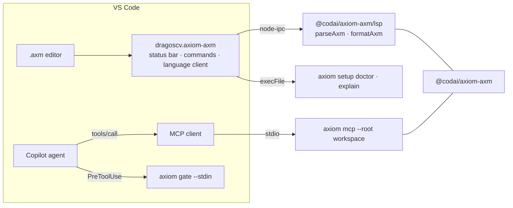

# VS Code

*The AXIOM extension (`dragoscv.axiom-axm`: gate status bar, Doctor/Init/Stats/Explain commands, `.axm` language support), where to install it, and the `mcp.json` / hook that make Copilot in VS Code go through the gate.*

Three separate pieces meet in VS Code, and you can adopt them independently:

| Piece | What it gives you | How |
|---|---|---|
| **AXIOM extension** | a status-bar item with the workspace gate state, the *AXIOM: Doctor / Init / Stats / Explain last decision* commands, and `.axm` language support (colouring, diagnostics, completion, hover, outline, *Format Document*, semantic tokens) | Marketplace / Open VSX `dragoscv.axiom-axm` |
| **MCP server** | Copilot agent mode can call the `axiom_*` tools against your workspace — the 6 `core` tools by default, all 19 with `--tools full` | `.vscode/mcp.json` |
| **PreToolUse hook** | every raw write Copilot makes through its own tools is gated | `.github/hooks/axiom-gate.json` |



## The extension

`packages/vscode-axm` — extension id `dragoscv.axiom-axm`, display name *AXIOM — agent write gate + .axm*,
VS Code ≥ 1.138. It does two jobs.

**Gate state.** A status-bar item shows the workspace gate state, computed from
`axiom setup doctor --json` (falling back to the pre-3.0 `axiom doctor --json`) and refreshed
periodically, on workspace trust and when `axiom.path` changes; warnings and failures colour the
item. Clicking it runs *Doctor*. Nothing runs in an untrusted workspace. Commands (Command Palette,
category **AXIOM**):

| Command | Title | What it runs |
|---|---|---|
| `axiom.doctor` | AXIOM: Doctor | `axiom setup doctor --json` → rendered in the *AXIOM* output channel, status bar updated |
| `axiom.init` | AXIOM: Init | `axiom setup init` after a modal confirmation (it writes hook / MCP / policy files) |
| `axiom.stats` | AXIOM: Stats | `axiom setup stats --json` |
| `axiom.explainLast` | AXIOM: Explain last decision | `axiom explain last` (needs axiom ≥ 3.0) |
| `axiom.refresh` | AXIOM: Refresh gate status | re-reads the doctor state |

Setting `axiom.path` (default `axiom`) names the CLI; on Windows `axiom.exe` and the npm
`axiom.cmd` shim are found automatically and the shim is run as `node <cli.js>`, never through a
shell.

**`.axm` language support.** Language id `axm`, file extension `.axm`. A
`vscode-languageclient` spawns the language server from `@codai/axiom-axm/lsp` over node-ipc —
the bundled copy, or the workspace's own `@codai/axiom-axm` when the workspace is trusted and has
it installed. A TextMate grammar colours the
file before the server answers — heredoc bodies and `check … {json}` / `meta {json}` as embedded
JSON — then semantic tokens refine it. `[axm]` defaults: semantic highlighting on, 2-space indent.

| Capability | What you get |
|---|---|
| diagnostics | the same `ERR_*`-coded errors `axiom plan compile` reports, at the offending range (`source: axm`); the editor and the gate share one parser, so they can never disagree (D-14) |
| completion | predicate ids after `using`, capability names inside `capabilities [ ]`, `mode`/`op`/`profile` values, keyword snippets valid at the current nesting level; triggers on space, `.`, `[` |
| hover | keyword docs; predicate docs on `using group.name` |
| document symbols | plan → artifacts + checks (outline, breadcrumbs) |
| formatting | canonical form (`formatAxm`) — applied only when the file parses without diagnostics |
| semantic tokens | `keyword`, `string`, `number`, `comment`, `property` (full document) |

### Install

From the VS Code Marketplace:

```sh
code --install-extension dragoscv.axiom-axm
```

([listing](https://marketplace.visualstudio.com/items?itemName=dragoscv.axiom-axm)). Cursor,
VSCodium and Windsurf install the same extension from
[Open VSX](https://open-vsx.org/extension/dragoscv/axiom-axm). The `.vsix` is also attached to
every [GitHub release](https://github.com/dragoscv/axiom/releases) (its version is stamped from
`@codai/axiom-mcp` at package time):

```sh
code --install-extension axiom-axm-<version>.vsix
```

or *Extensions view → ⋯ → Install from VSIX…*. The gate commands need the `axiom` CLI on PATH
(`npm i -g @codai/axiom-mcp`) or `axiom.path` set; `.axm` support works without it.

Other editors: the language server is a plain LSP 3.18 binary shipped in `@codai/axiom-axm` as the
`axm-lsp` bin — `npx -p @codai/axiom-axm axm-lsp --stdio` for neovim, helix, zed, emacs
([axm-syntax.md § Editor support](../reference/axm-syntax.md#editor-support)). The former
`@codai/axiom-axm-lsp` package is deprecated and only re-exports it through 3.x.

### Develop it

```sh
pnpm build                              # builds @codai/axiom-axm (parser + language server)
pnpm --filter axiom-axm run build       # the extension (not matched by the @codai/axiom-* filter)
code --extensionDevelopmentPath=packages/vscode-axm   # or F5 "Run Extension"
pnpm --filter axiom-axm run package     # → .copilot-tmp/axiom-axm-<version>.vsix
```

Details and the vsce/pnpm quirks: [`packages/vscode-axm/README.md`](../../packages/vscode-axm/README.md),
[`packages/axm/README.md`](../../packages/axm/README.md).

## The MCP server — `.vscode/mcp.json`

```json
{
  "servers": {
    "axiom": {
      "type": "stdio",
      "command": "npx",
      "args": ["-y", "@codai/axiom-mcp", "mcp", "--root", "${workspaceFolder}"]
    }
  }
}
```

`${workspaceFolder}` becomes the single allowlisted root; add more `--root` pairs for a multi-root
workspace. `npx` is fine here — the server starts once per session. In agent mode Copilot then
sees the six `core` tools — `axiom_write`, `axiom_status`, `axiom_rollback`, `axiom_check`,
`axiom_apply_dry_run`, `axiom_apply`; add `"--tools", "full"` to the args for all 19, including
`axiom_plan_compile` ([mcp-tools.md](../reference/mcp-tools.md)); `axiom_apply` carries `destructiveHint: true`, so
VS Code asks before running it unless you auto-approve it in `chat.tools.global.autoApprove`.

For a long-lived shared server use the HTTP transport instead:

```json
{ "servers": { "axiom": { "type": "http", "url": "http://127.0.0.1:3411/mcp" } } }
```

started with `axiom mcp --root /abs/repo --http 127.0.0.1:3411`. Add
`"headers": { "Authorization": "Bearer ${input:axiom-token}" }` when the server has a token
(required for any non-loopback bind).

> [!TIP]
> To make an agent *prefer* the gate over raw file tools, add a short instruction to
> `.github/copilot-instructions.md` — metu's is a skill that says "never raw multi-file writes when
> AXIOM is available; Plan → compile → check → dry-run → apply with `confirmDigest`"
> ([integration/metu.md](metu.md)).

## The hook — `.github/hooks/axiom-gate.json`

VS Code agent hooks (Preview) load `.github/hooks/*.json` from the workspace and
`.claude/settings.json`, plus the user-level `~/.copilot/hooks` and `~/.claude/settings.json`.
Install the global bin first (`npm i -g @codai/axiom-mcp` — never `npx` in a hook), then:

```json
{
  "version": 1,
  "hooks": {
    "preToolUse": [
      {
        "type": "command",
        "command": "axiom gate --stdin --format auto",
        "bash": "axiom gate --stdin --format auto",
        "powershell": "axiom.cmd gate --stdin --format auto; exit $LASTEXITCODE",
        "timeoutSec": 15
      }
    ]
  }
}
```

`axiom setup init` writes exactly this. VS Code ignores `exec`/`args` entries (Copilot-CLI-only), so
a hook file that only has them never runs in VS Code and `axiom setup doctor` fails on it. New or
changed hook files load after **Developer: Reload Window**; the workspace must be trusted. Check
it worked in the "GitHub Copilot Chat Hooks" output channel (a `Running: {"command":"axiom…gate…"}`
line per tool call), with `axiom setup doctor` (`hook.log.vscode`) or by glancing at the extension's status bar item.

VS Code sends `tool_name` / `tool_input` in snake_case where the Copilot CLI sends camelCase; the
gate reads both. Sub-agents started in `apps/web` still resolve the repository root because the
gate walks up from `cwd` to the nearest `.git` ([hooks.md § Root discovery](../getting-started/hooks.md#root-discovery)).
The gate policy lives in `<root>/.axiom/axiom.json` (the older `.axiom/gate-profile.json` is still
read with a deprecation warning — see [profiles.md](../reference/profiles.md)). Full contract and the other
harnesses: [hooks.md](../getting-started/hooks.md), [harnesses.md](harnesses.md).

## Putting it together

A workspace that has all three:

```
.vscode/mcp.json                 → axiom mcp --root ${workspaceFolder}
.github/hooks/axiom-gate.json    → axiom gate --stdin (global bin)
.axiom/axiom.json                → gate policy + checks (deny .git/**, .axiom/**, lockfiles, .env*, house pack, …)
.gitignore                       → .axiom/* plus !-negations for the committed policy files
plans/*.axm                      → edited with the extension, compiled by axiom plan compile
```

---

**See also**

- [`.axm` syntax](../reference/axm-syntax.md) — what the extension understands
- [Harnesses](harnesses.md) — the same config for the other eleven harnesses
- [Hooks](../getting-started/hooks.md) — the PreToolUse contract in depth
- [Install](../getting-started/install.md) — the extension among the other channels
