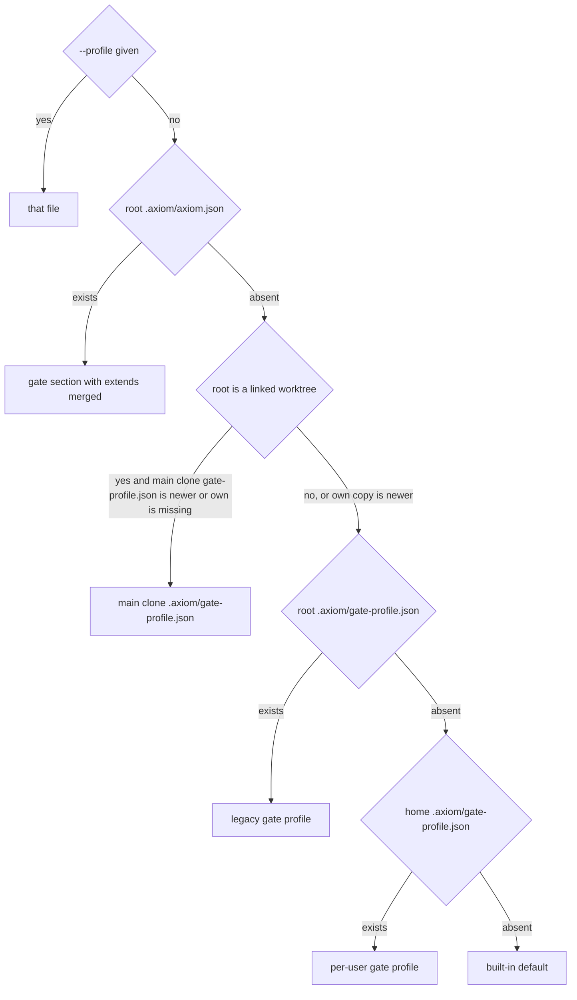
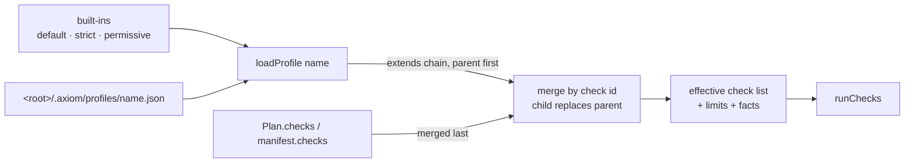

# Profiles

*Every AXIOM policy file in one place: `.axiom/axiom.json`, how `extends` and packs merge, where the gate looks for its policy, every gate key, modes and overrides, and the check `Profile` schema with its built-ins.*

AXIOM judges two things, with two policies:

- the **gate** judges one tool call at a time (a write, a shell command) inside the agent's
  hook, in about 100 ms — its policy is the `gate` section;
- **`check` / `apply`** judge a whole change set (a manifest) with typed predicates — their
  policy is a check `Profile`, the `checks` section.

Since 3.0 both live in one file, `.axiom/axiom.json`. The 2.x files
(`.axiom/gate-profile.json`, `.axiom/profiles/<name>.json`) are still read. Terms used below
are defined in the [glossary](../concepts/glossary.md).

> [!IMPORTANT]
> In this release the **gate** reads the `gate` section of `.axiom/axiom.json`. The `check` and
> `apply` commands and MCP tools still resolve check profiles from `.axiom/profiles/<name>.json`
> and the built-ins; the `checks` section is validated, merged and written by
> `axiom setup migrate --profile`, but is not yet what `check`/`apply` evaluate. Keep
> `.axiom/profiles/<name>.json` until that lands.

## `.axiom/axiom.json`

Since 3.0. Schema: `AxiomConfigFileSchema` in `packages/schema/src/config.ts`; loader:
`packages/mcp/src/profile-v3.ts`. The file is a loose object: unknown top-level keys produce
one warning naming them and are ignored, so a file written for a newer 3.x still works on an
older 3.x. The file never participates in a digest.

| Key | Type | Meaning |
|---|---|---|
| `$schema` | string | optional editor hint, e.g. `https://dragoscv.github.io/axiom/schemas/v3/AxiomConfig.schema.json` |
| `version` | positive int | policy format major; this release understands `3`. A higher value is refused with `ERR_PROFILE_VERSION` — never half-understood, never fail-open |
| `extends` | `string[]`, ≤ 32 entries | layers merged under this file, in order (see below) |
| `allowNpmPacks` | boolean | allow `extends` to name npm packages outside `@codai/`; honoured only in the root file, not in an extended layer |
| `gate` | object | the gate policy, validated by `GateProfileSchema` after merging — see [Gate keys](#gate-keys) |
| `checks` | object | the check profile: the [`Profile`](#check-profile-schema) fields without `apiVersion`/`kind`; `name` defaults to `axiom` |

A `checks` section that sets neither `checks` nor `extends` extends the built-in `default`
profile, so a gate-only file is never weaker than having no file. The `checks` profile answers
a request for its own `name` and for `default` (the repository policy is the repository's
default).

### `extends` resolution

Entries are resolved in order; **later entries win, and the file itself is applied last.**

| Entry form | Resolved as |
|---|---|
| `./base.json`, `../shared/x.json` (or an absolute path) | a file relative to the **declaring** file. Its realpath must stay inside the repository root or `~/.axiom`, so a symlink cannot bring a file in from elsewhere |
| `axiom:default`, `axiom:strict`, `axiom:permissive` | a built-in pack (table below) |
| `@codai/axiom-pack-<name>` | an npm package resolved from the repository root. It must already be in `node_modules` — AXIOM never installs anything — and ship `axiom-pack.json`, exposed through `exports["./axiom-pack.json"]` or named by `package.json#axiomPack` (which must stay inside the package). Packages from any other scope need `allowNpmPacks: true` |

An extended file is itself an `axiom.json`-shaped document and may have its own `extends`.

Built-in packs (`BUILTIN_PACKS`):

| Pack | `checks` | `gate` |
|---|---|---|
| `axiom:default` | extends the built-in `default` profile | `deny`: the built-in deny list; `steer: "hint"` |
| `axiom:strict` | extends the built-in `strict` profile | `deny`: the built-in deny list + `.github/workflows/**`; `steer: "hint"`; `outside: "deny"`; `noSecrets: true`; `pii: true`; `commands: { pack: "house" }` |
| `axiom:permissive` | extends the built-in `permissive` profile | `deny: [".git/**", ".axiom/**"]`; `outside: "warn"` |

The built-in deny list is `.git/**`, `.axiom/**`, `**/*.lock`, `pnpm-lock.yaml`, `.env`,
`.env.*`, `**/node_modules/**`.

### Merge rules

- Objects deep-merge; scalars are replaced by the later layer.
- `deny`, `ask`, `hard` and `allow` arrays are **unioned** at every depth: a pack or a later
  layer can add entries but never drop a deny.
- A `checks` list of `{ id, … }` entries merges by `id`: a later entry with the same id
  replaces the earlier one, new ids are appended.
- Every other array is replaced.
- A cycle, or nesting deeper than 8 levels (the root file is level 0), is
  `ERR_INVALID_PROFILE`. So are invalid JSON, a schema violation, an unreadable or missing
  extends file, a file outside the allowed directories, an unknown `axiom:` pack and an npm pack
  that is not installed.

### Example

```json
{
  "$schema": "https://dragoscv.github.io/axiom/schemas/v3/AxiomConfig.schema.json",
  "version": 3,
  "extends": ["axiom:strict", "./team-policy.json"],
  "gate": {
    "mode": "enforce",
    "ask": ["infra/**", "packages/db/drizzle/**"],
    "maxBytes": 262144,
    "record": true,
    "commands": {
      "pack": "house",
      "deny": [
        { "id": "repo.noPrismaPush", "argv": ["prisma", "db", "push"],
          "reason": "schema changes go through migrations", "fix": "pnpm db:generate" }
      ]
    },
    "hard": ["house.forcePush", "house.resetHard", "house.cleanForce", "house.worktreeRemoveForce"],
    "sessions": { "foreignWrite": "ask", "budget": { "maxDeletes": 20 } }
  },
  "checks": {
    "extends": "strict",
    "checks": [
      { "id": "path.allow", "predicate": "path.allow",
        "params": { "globs": ["apps/**", "packages/**", "docs/**"] } },
      { "id": "content.noSecrets", "predicate": "content.noSecrets", "params": { "pii": true } }
    ]
  }
}
```

With `axiom:strict` first, the effective `gate.deny` is the strict list plus anything
`team-policy.json` and this file add; `hard` is the union of all three layers.

Moving from the 2.x files: `axiom setup migrate --profile` (old verb
`axiom migrate --profile`) folds `.axiom/gate-profile.json` and `.axiom/profiles/<name>.json`
into a new `.axiom/axiom.json`; see [MIGRATION.md](../../MIGRATION.md#from-2x-to-30).

## Where the gate finds its policy

`loadGateProfileForRoot` and `loadGateProfile` in `packages/mcp/src/gate.ts`. The first hit
wins; layers are never merged across these locations:

1. `--profile <file>` — always wins. A missing file is `ERR_INVALID_PROFILE`, not a fallback.
2. `<root>/.axiom/axiom.json` — its `gate` section, with `extends` resolved.
3. `<root>/.axiom/gate-profile.json` — the 2.x file, still read.
4. `~/.axiom/gate-profile.json` — a per-user fallback.
5. The built-in default (`DEFAULT_GATE_PROFILE`).

**Slot inheritance.** When `<root>` is a linked git worktree (an agent slot: its `.git` is a
file whose `gitdir` back-links to it, and `commondir` names the main clone's `.git`) and the
slot has no `axiom.json`, the slot inherits the main clone's `.axiom/gate-profile.json` if its
own copy is missing or older (by mtime). A slot whose own profile is newer keeps it. A policy
change in the main clone therefore reaches every slot without copying files.



Check profiles are looked up separately: a named profile resolves from
`<root>/.axiom/profiles/<name>.json`, then the built-ins (see [Discovery](#discovery)).

A profile that cannot be used — invalid JSON, a schema violation, a bad `extends` — is
`ERR_INVALID_PROFILE`; a `version` above 3 is `ERR_PROFILE_VERSION`. Neither is covered by the
gate's `--fail-open`: an unusable policy never turns the gate off. Unknown keys are not an
error: the gate logs one warning naming them and ignores them.

## Gate keys

`GateProfileSchema` in `packages/mcp/src/gate.ts`. The gate is flat on purpose: it has ~100 ms
and sees one tool call at a time. Defaults are the schema defaults, which apply to any explicit
policy (a `gate` section or a gate profile file). The built-in default, used only when no file
exists, differs in two places: it carries the built-in deny list and `steer: "hint"`.

| Key | Type | Default | Meaning | More |
|---|---|---|---|---|
| `version` | positive int | — | policy format major; above 3 → `ERR_PROFILE_VERSION` | |
| `deny` | `string[]` (globs) | `[]` (built-in: the deny list above) | any target matching a glob (picomatch, `dot: true`) → deny `path.deny`; applies to write tools and shell operands | |
| `ask` | `string[]` (globs) | `[]` | a match hands the decision to the human (`path.ask`); every deny wins over an ask; formats without an ask prompt get a deny | [human-confirm.md](../guides/human-confirm.md) |
| `allow` | `string[]` (globs) | — | when present, every target must match one glob, else `path.allow` | |
| `noSecrets` | boolean | `true` | run `content.noSecrets` on supplied content | [checks.md](../guides/checks.md#contentnosecrets) |
| `pii` | boolean | `false` | also scan for personal data (`cnp`, `email`, `phoneRo`, `card`) | [The `pii` knob](#the-pii-knob) |
| `noSecretsExclude` | `string[]` (globs) | — | paths where the PII-class findings (`email`, `phoneRo`, `cnp`, `card`, `credentialAssignment`) are ignored, e.g. test fixtures; real keys are still reported everywhere | |
| `maxBytes` | positive int | — | run `content.maxBytes` on supplied content | |
| `steer` | `"off"` \| `"hint"` \| `"require"` | `"off"` (built-in: `"hint"`) | `hint`: a once-per-session hint pointing the agent at `axiom_write`; `require`: also deny direct writes matching `steerGlobs` (`steer.requireApply`) | |
| `steerGlobs` | `string[]` (globs) | `[]` | targets a direct write may not touch under `steer: "require"` | |
| `record` | boolean | `false` | append every judged decision to `.axiom/decisions.jsonl` | [stats.md](../guides/stats.md) |
| `commands` | object | — | shell command rules — see [`commands`](#commands) | [command-rules.md](../guides/command-rules.md) |
| `sessions` | object | — | cross-session and blind-overwrite rules, write budgets — see [`sessions`](#sessions) | [sessions.md](../guides/sessions.md) |
| `undo` | boolean | `false` | capture the pre-image of every allowed write into the CAS for `axiom journal undo --session` | [undo.md](../guides/undo.md) |
| `coordination` | object | — | file-protocol marks, leases and queue-required commands — see [`coordination`](#coordination) | [coordination.md](../guides/coordination.md) |
| `git` | object | — | git-state rules read from `.git` without spawning git — see [`git`](#git) | |
| `shadow` | boolean | `false` | never deny; record what the gate would have decided (and the shell command) to `.axiom/decisions.jsonl` for a replay before a cutover | |
| `mode` | `"enforce"` \| `"warn"` | `"enforce"` | see [Modes, hard codes and overrides](#modes-hard-codes-and-overrides) | |
| `hard` | `string[]` | `[]` | codes that always deny in every mode and cannot be overridden | |
| `override` | boolean | `false` | let the agent pass a non-hard deny by stating a reason | |
| `outside` | `"deny"` \| `"warn"` \| `"allow"` | `"deny"` | targets outside the root (and outside every worktree of the same repository): `ERR_CONTAINMENT`, allow with a warning, or allow (still a warning for operating-system directories) | |

Contract, wiring and shell scanning: [hooks.md](../getting-started/hooks.md#profile-file).

### What `axiom setup init` writes

`GATE_PROFILE` in `packages/mcp/src/init.ts`, written to `.axiom/gate-profile.json`:

```json
{
  "version": 3,
  "deny": [".git/**", ".axiom/**", ".github/**", "pnpm-lock.yaml", "**/*.lock",
           ".env", ".env.*", "**/.env", "**/.env.*",
           "**/node_modules/**", "**/.next/**", "**/dist/**"],
  "noSecrets": true,
  "pii": false,
  "maxBytes": 262144,
  "steer": "hint",
  "record": true,
  "mode": "enforce",
  "commands": { "pack": "house" },
  "hard": ["house.forcePush", "house.resetHard", "house.cleanForce", "house.worktreeRemoveForce"]
}
```

The house command pack is on, and the four irreversible git operations deny in every mode and
cannot be overridden.

### `commands`

`CommandsConfigSchema` in `packages/mcp/src/command-rules.ts` (strict object).

| Key | Type | Default | Meaning |
|---|---|---|---|
| `deny` | `CommandRule[]` | `[]` | your own rules, evaluated against every simple command the shell line runs (including nested `bash -c`, `pwsh -Command`, heredocs fed to a shell) |
| `pack` | `"none"` \| `"house"` | `"none"` | `house` adds the built-in rules below |

A `CommandRule` (strict object; `pattern` or `argv` is required):

| Field | Type | Meaning |
|---|---|---|
| `id` | string | verdict code; default `command.deny` |
| `pattern` | regex source (≤ 500 chars) | matches the command text |
| `argv` | `string[]` (≥ 1) | matches the leading argv tokens |
| `unless` | regex source | a command matching it is exempt |
| `reason` | string | shown to the agent |
| `fix` | string | the command to run instead |
| `decision` | `"deny"` \| `"ask"` | default `deny` |
| `caseSensitive` | boolean | regexes are case-insensitive by default |

Every matching rule is evaluated; if any match is a `hard` code, that one decides.

House pack (`HOUSE_PACK`):

| Id | Refuses |
|---|---|
| `house.gitAddAll` | `git add -A` / `--all` / `.` |
| `house.gitCommitAll` | `git commit -a` / `-am` / `--all` |
| `house.forcePush` | `git push --force`, `-f`, `--force-with-lease` |
| `house.pushDelete` | `git push --delete` / `-d` / `<remote> :<ref>` |
| `house.resetHard` | `git reset --hard` |
| `house.cleanForce` | `git clean -f` |
| `house.checkoutDiscard` | `git checkout -- <path>` / `git checkout .` |
| `house.restore` | `git restore` |
| `house.stashFlagsAfterDashDash` | `git stash push … -- … -m` (flags after `--` become paths) |
| `house.stashDrop` | `git stash drop` / `clear` |
| `house.stashBare` | `git stash pop` / `apply` / `drop` without `stash@{N}` |
| `house.sqlDestructive` | dropping or truncating a table, database or schema |
| `house.sqlDeleteAll` | a `DELETE FROM <table>` with no `WHERE` |
| `house.rmRoot` | `rm -rf /` or `~` |
| `house.removeItemRoot` | `Remove-Item -Recurse -Force` at a drive root |
| `house.commitNoPathspec` | `git commit` without `-- <paths>` (exempt: `agentq.ps1`, `commit-tree`, `--amend`, `--allow-empty`) |
| `house.worktreeRemoveForce` | `git worktree remove --force` / `-f` |
| `house.worktreeRawRemove` | raw `git worktree remove` / `move` outside `worktree.ps1` / `agentq.ps1` / `deploy-clean.ps1` |
| `house.worktreeRawAdd` | raw `git worktree add` outside those wrappers |
| `house.playwrightLocal` | local `playwright test` runs (exempt with `PW_ALLOW_LOCAL=1`) |
| `house.buildUnqueued` | `pnpm build` / `typecheck`, `turbo build`, `next build`, `tsc --noEmit` outside `run-build.ps1` / `agentq.ps1` |
| `house.undecodable` | a nested command AXIOM cannot read (undecodable `-EncodedCommand`, nesting deeper than 3) — decision `ask` |

`command.deployNeedsCleanTree` (`HOUSE_DEPLOY_RULE`) is not in the pack: the gate adds it only
when a git-state fact reports uncommitted changes. It refuses deploy and release commands
(`gcloud run deploy`, `vercel --prod`, `docker build|push`, `terraform apply`, `npm publish`, …)
outside `deploy-clean.ps1`.

### `sessions`

`SessionsConfigSchema` in `packages/mcp/src/session-guard.ts` (strict object). Details:
[sessions.md](../guides/sessions.md).

| Key | Type | Default | Meaning |
|---|---|---|---|
| `foreignWrite` | `"off"` \| `"ask"` \| `"deny"` | `"off"` | a write to a file another agent session wrote within `windowMin` → `session.foreignWrite` |
| `windowMin` | int 1–1440 | `15` | the foreign-write window in minutes |
| `blindOverwrite` | `"off"` \| `"ask"` \| `"deny"` | `"off"` | a whole-file overwrite of a file this session never read → `blind.overwrite` |
| `trackReads` | boolean | `false` | record reads (needed by `blindOverwrite`) |
| `staleScript` | boolean | `true` | refuse running a script file another session changed since this session last saw it → `blind.staleScript` |
| `budget` | object | — | per-session write budget → `sessions.budget` |
| `budget.maxFiles` | int ≥ 1 | — | distinct files written within the window |
| `budget.maxDeletes` | int ≥ 0 | — | deletes within the window |
| `budget.windowMin` | int 1–10080 | `60` | budget window in minutes |
| `budget.decision` | `"ask"` \| `"deny"` | `"ask"` | verdict when the budget is exceeded |

### `git`

`GitRulesSchema` in `packages/mcp/src/gitfacts.ts` (strict object). Command classes are
`build`, `install`, `commit`, `deploy`.

| Key | Type | Default | Meaning |
|---|---|---|---|
| `cleanTreeFor` | class[] | `[]` | commands of these classes need a clean tree (index = HEAD, worktree = index) → `git.dirtyTree` |
| `untracked` | boolean | `false` | also count untracked files |
| `requirePathspec` | boolean | `false` | refuse `git commit` without ` -- <path>` → `git.noPathspec` |
| `branch` | `{ is, for, reason? }` | — | commands of classes `for` run only on a branch matching `is` (exact or `*` glob) → `git.branch` |

A git state that cannot be read fails closed with `git.dirtyTree`.

### `coordination`

`CoordinationSchema` in `packages/mcp/src/coord.ts` (strict object). Details:
[coordination.md](../guides/coordination.md).

| Key | Type | Default | Meaning |
|---|---|---|---|
| `marksDir` | string | — | directory of mark files (`*.json`); `~` and `${env:NAME}` expand → `coord.frozen` |
| `leasesDir` | string | — | directory of lease files (`<repo>/<slot>.json`) → `coord.leased` |
| `slotsRoot` | string | — | root of worktree slots (`<slotsRoot>/<repo>/<slot>`) for leases without a `path` |
| `exemptVia` | regex[] | `["agentq\\.ps1"]` | a command matching any is exempt from marks, leases and the queue rule |
| `queueRequired` | `{ class, via, fix }[]` | `[]` | commands of `class` must match `via` (the sanctioned wrapper) → `coord.queueRequired` |
| `repo` | string | — | repository name; default the lowercased leaf of the git common dir's parent |

### Modes, hard codes and overrides

**`mode`.** `enforce` denies. `warn` turns a deny into an allow that carries the reason to the
agent as a warning, journaled with `relaxed: "warn"`. Codes listed in `hard` still deny, and
`ask` globs still ask.

**`hard`.** Entries are an exact code, a `prefix.*` (every code starting with `prefix.`), or
`*`. A hard code denies in every mode and cannot be overridden. `git.destructiveTree` (a shell
command whose target is the whole tree, such as `git clean` or `git reset --hard`) is hard
whenever `house.resetHard` or
`house.cleanForce` is hard. Every matching command rule is evaluated, and a hard match wins over
an earlier relaxable one — evaluation order never decides.

**`override: true`.** The agent may pass a non-hard deny by stating why. The gate reads the
reason from exactly two places:

- `axiom-override: <reason>` in one of the tool input's prose fields — `explanation`, `goal`,
  `description`, `reason`, `justification`. The reason runs to the end of the line.
- A trailing shell comment `# axiom-override: <reason>`, the last thing in the command, outside
  quotes and heredoc bodies (bash and PowerShell readings must agree).

It is never read from a command body, from `apply_patch` text, from file content or from a
quoted string. A reason needs ≥ 3 words containing letters and ≥ 12 letters in total, and at
most 300 characters. The trailing comment is stripped before the command is scanned for write
targets. The decision is journaled with `relaxed: "override"` and `override_reason`.

```text
pnpm build   # axiom-override: release candidate build agreed with the owner
```

**`outside`.** `deny` (default) refuses a target outside the root with `ERR_CONTAINMENT`;
`warn` allows it with a warning; `allow` allows it, warning only for operating-system
directories. A target in a sibling worktree of the same repository is judged against that
worktree's root, not as outside.

## Check profile schema

`packages/schema/src/profile.ts` → `ProfileSchema`, served as `axiom://schema/Profile` and
`axiom schema Profile`. Every object is strict. A profile is the operator's statement of what a
change set must satisfy: a named list of typed predicates plus limits and provider switches.
`check` and `apply` run the resolved profile's checks **and** the manifest's own `checks[]`;
anything other than `verdict: pass` blocks apply. Predicate semantics and every `params` shape
live in [checks.md](../guides/checks.md).



| Field | Type | Constraint |
|---|---|---|
| `apiVersion` | literal | `"axiom.codai.ro/v3"`; `"axiom.dev/v2"` still parses |
| `kind` | literal | `"Profile"` |
| `name` | string | `^[a-z0-9][a-z0-9._-]{0,63}$`; for a file profile it must equal the file stem |
| `extends` | profile name | optional; resolved parent-first; cycle or missing parent → `ERR_INVALID_PROFILE` |
| `checks` | `CheckRef[]` | `{ id, predicate, params, severity? }` — see [plan-format.md](plan-format.md#checkref) |
| `limits` | `{ maxArtifacts?, maxTotalBytes?, maxBlobBytes? }` | positive ints; merged shallowly, child over parent |
| `facts` | `{ allowRepo: bool = true, allowGuards: bool = false }` | `allowRepo: false` skips every `repo.*` predicate and hides `repo` from `expr.cel`/`expr.cedar`; `allowGuards: true` is one of the **two** switches `guard.external` needs (the other is the process flag `--allow-guards`) |

Violations of the schema, a bad name, or an unreadable file are `ERR_INVALID_PROFILE` with
`details.issues`.

## Built-in profiles

Defined in `packages/checks/src/profile.ts` (`BUILTIN_PROFILE_INPUTS`), served as
`axiom://profile/default`, `…/strict`, `…/permissive`. Side by side:

| Check id | Predicate | `default` | `strict` (extends `default`) | `permissive` |
|---|---|---|---|---|
| `path.reservedNames` | `path.reservedNames` | `{}` | inherited | `{}` |
| `content.noSecrets` | `content.noSecrets` | `{}` (secrets only, `pii: false`) | inherited | — |
| `manifest.maxArtifacts` | `manifest.maxArtifacts` | `{ "max": 2000 }` | inherited | — |
| `manifest.maxTotalBytes` | `manifest.maxTotalBytes` | `{ "max": 67108864 }` (64 MiB) | inherited | — |
| `repo.noOverwriteOf` | `repo.noOverwriteOf` | `{ "globs": [".git/**", ".axiom/**", "**/*.lock", "pnpm-lock.yaml", ".env*"] }` | inherited | — |
| `manifest.noDeletes` | `manifest.noDeletes` | — | `{}` | — |
| `deps.max` | `deps.max` | — | `{ "max": 50 }` | — |
| `path.deny` | `path.deny` | — | `{ "globs": ["**/node_modules/**"] }` | — |
| **`limits`** | | `{ maxArtifacts: 2000, maxTotalBytes: 67108864 }` | inherited | none |
| **`facts`** | | `{ allowRepo: true, allowGuards: false }` | same | same |

`default` is what `check`/`apply` use when a Plan names no profile. It protects the repository's
own control files from an agent overwrite (`.git`, `.axiom`, lockfiles, `.env*`), scans for
credentials, and caps set size; it does **not** restrict where an agent may write — that is a
repository decision, expressed with `path.allow`/`path.deny`. `permissive` runs only the
path-sanity check and exists for scratch repos and tests.

> [!NOTE]
> Adding an `error`-severity check to `default` is a **breaking** change for everyone applying
> through it ([versioning.md](versioning.md)). New default checks arrive as `warn`/`info`.

## The `pii` knob

`content.noSecrets` always scans for secrets (`credentialAssignment`, `awsKey`, `githubToken`,
`privateKey`, `jwt`, `slackToken`). Personal-data patterns (`cnp`, `email`, `phoneRo`, `card`)
are **opt-in** with `"pii": true`: replaying 30 OSS repositories through an all-on default
rejected 110 of 3240 real files on maintainer e-mails alone. Turn it on where personal data in a
source tree is a policy question:

```json
{ "id": "content.noSecrets", "predicate": "content.noSecrets", "params": { "pii": true } }
```

Because checks merge by `id`, that one line in a child profile *re-parameterises* the default
check rather than adding a second scan. The gate has the same knob (`pii`, plus
`noSecretsExclude`). Precision rules and the corpus numbers:
[checks.md § content.noSecrets](../guides/checks.md#contentnosecrets).

## `extends` and merging for check profiles

`loadProfile(name, { searchDirs })` resolves:

1. **Lookup** — each search directory in order for `<name>.json`, then the built-ins. First hit
   wins; files are not merged with a same-named built-in.
2. **Parents first** — the `extends` chain is loaded recursively; a cycle or a missing parent is
   `ERR_INVALID_PROFILE`.
3. **Checks merge by `id`** — a child entry **replaces** the parent's entry with the same id
   (change params, severity or even the predicate), and appends otherwise. There is no
   "remove"; to silence an inherited check, override it with the same id and `"severity": "info"`.
4. **`limits` and `facts` merge shallowly**, child over parent.
5. **The Plan's own `checks[]`** are merged last with the same rule — a Plan can tighten or
   re-parameterise, and the result is what `CheckReport.profile` names.

```json
{
  "apiVersion": "axiom.codai.ro/v3", "kind": "Profile", "name": "web",
  "extends": "strict",
  "checks": [
    { "id": "path.allow", "predicate": "path.allow",
      "params": { "globs": ["apps/web/**", "packages/ui/**", "docs/**"] } },
    { "id": "content.noSecrets", "predicate": "content.noSecrets",
      "params": { "pii": true, "allowPaths": ["**/*.test.ts"] } },
    { "id": "ripple.schema", "predicate": "repo.requireCompanion",
      "params": { "rules": [ { "when": "packages/db/src/schema/*.ts",
        "expect": [ { "name": "migration", "match": "packages/db/drizzle/*.sql", "mustChange": true } ] } ] } }
  ]
}
```

## Discovery

The CLI (`--profile <name>`) and the MCP server (`profile` argument) resolve a named check
profile from `<root>/.axiom/profiles/<name>.json`, then the built-ins. The file name is the
profile name; `name` inside must match. This is the location `check`/`apply` read today (see
the note at the top of this page about the `checks` section).

Commit the policy files — they are the repository's policy, reviewed like CI configuration —
and keep the rest of `.axiom/` ignored:

```gitignore
.axiom/*
!.axiom/axiom.json
!.axiom/profiles/
!.axiom/gate-profile.json
```

A Plan selects its profile with `"profile": "web"`; the CLI/MCP `--profile`/`profile` overrides
it; `apply` defaults to the manifest's `profile`. The `default` profile's `repo.noOverwriteOf`
refuses a manifest that rewrites `.axiom/**`, and `apply` refuses any artifact under `.axiom/`
(`ERR_PATH_RESERVED_DIR`), so an agent cannot edit the policy it is judged by through AXIOM.

## Guards need two switches

`guard.external` (your own `scripts/check-*.mjs` as a predicate) is disabled twice by default:
the profile must set `facts.allowGuards: true` **and** the process must be started with
`--allow-guards` (plus `--guard-allowlist <abs>` for absolute commands). Neither switch is
reachable from an MCP tool; a profile that asks for guards on a process without the flag yields
`verdict: error` (`ERR_FACT_DISABLED`) — fail closed, never skipped. Long suites belong in
`axiom_check_start` tasks ([mcp-tools.md § Tasks](mcp-tools.md#tasks-d-24)). Worked example:
[integration/brivio.md](../integration/brivio.md).

## Resources and introspection

- `axiom://profile/<name>` — the built-in profiles as JSON.
- `axiom schema Profile` / `axiom://schema/Profile` — the JSON Schema.
- `CheckReport.profile` — the resolved name the report was judged with; `factsDigest` lets it be
  replayed.

---

**See also**

- [Checks](../guides/checks.md) — every predicate and its params
- [Command rules](../guides/command-rules.md) — writing `commands.deny` rules
- [Plan format](plan-format.md#profile) — `Profile` among the other wire types
- [Hooks](../getting-started/hooks.md) — the gate policy in context
- [Error codes](error-codes.md#gate-rule-codes) — every gate rule code
- [Trust model](../concepts/trust-model.md) — why policy is operator-owned and fails closed
